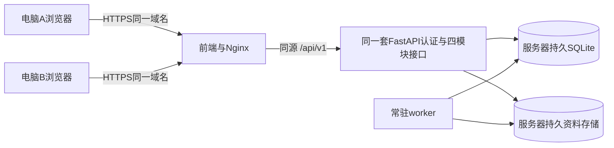

# 跨电脑账号与云端学习数据

用户后续已决定暂缓云部署，继续本地功能。本页保留已完成的适配与部署参考，不作为当前实施中的上线任务。

2026-10-23，PLATFORM-CLOUD-ACCOUNT-22，Codex辅助zhy。[契约](../../contracts.md#platform-cloud-account-22)与[交接023](../../../collaboration/handoff.md#h-20261023-zhy-023)。当前完成部署适配与隔离验证；未购买、连接或部署云服务器，未上传日常账号、数据库或凭据。真实部署接收需按文末核验。

## 为什么另一台电脑找不到test

目前默认前端访问本机`http://127.0.0.1:8000/api/v1`，后端使用`sqlite:///./data/hustudy.db`，文件在`./data/storage`。A电脑注册test只写入A的数据库；B电脑运行同一套源码仍会启动B自己的数据库。两边同名用户也可能有不同UUID，不是同一账户。

GitHub保存源码；`.gitignore`排除数据库、data、.env和密钥。上传代码不会上传或合并运行数据。GitHub Pages也只托管静态HTML/CSS/JS，不能单独运行本项目FastAPI/worker/数据库，见[GitHub官方说明](https://docs.github.com/en/pages/getting-started-with-github-pages/what-is-github-pages)。不应通过取消忽略规则来传播账号库或凭据。

## 推荐的集中部署



初期采用单台Linux服务器承载现有架构，所有人只需打开同一个HTTPS网址，无需运行localhost。数据库、原件/图片、解析结果与worker共同使用同一份持久数据。部署发布代码时保留独立的`/var/lib/hustudy`，不得用重新创建的空库替换。已有[systemd与Nginx示例及部署顺序](worker_deployment.md#单机linux部署示例)可复用；本轮未执行远程安装、证书签发或上线。

这是集中存储与在线读写，不是多台本地数据库自动双向合并。单服务器使用本机SQLite可支持小规模网站，但本项目容量须实测；不要用共享网络盘让多台服务器直接打开SQLite。参考[SQLite官方适用范围](https://sqlite.org/whentouse.html)。当前实现包含SQLite PRAGMA、FTS与专用事务逻辑，不能仅改DATABASE_URL就宣称支持PostgreSQL。更多并发/多实例需要另行适配数据库、文件存储、worker锁和任务分发并测试。

## 已修正的代码与配置

所有现有API、文件下载和带认证读取共用同一API基址，不在页面各自维护地址：

| 场景 | 默认或配置 |
| --- | --- |
| 本地开发，未指定地址 | `http://127.0.0.1:8000/api/v1`，保持原方式 |
| 正式构建，未指定地址 | `/api/v1`，浏览器访问当前网站域名下的API，不再回连访问者本机 |
| 显式指定 | `VITE_API_BASE_URL`优先，可用相对路径或公共API完整地址；规范空白/末尾斜杠 |

同源部署构建命令（在项目根目录）：

```sh
VITE_API_BASE_URL=/api/v1 npm run build --prefix frontend
```

Nginx发布`frontend/dist`，将`/api/`转发服务器内部FastAPI，数据库和文件目录不公开为静态资源。后端沿[生产环境模板](../../../deploy/hustudy.env.example)设置production、绝对持久数据路径、强随机JWT密钥与外部worker守护，详见[部署说明](worker_deployment.md)。前端的修正不会自行创建服务器、迁移数据或改变本地test。

开发阶段也可以让两位同学各自运行5173前端，但统一连接已部署的公共HTTPS API。在每台电脑新建`frontend/.env.local`（不要提交）：

```dotenv
VITE_API_BASE_URL=https://study.example.com/api/v1
```

将示例域名换成实际服务地址。公共后端的`HUSTUDY_CORS_ORIGINS`须显式允许使用的前端来源，例如`http://localhost:5173,http://127.0.0.1:5173,https://study.example.com`；这些来源只是CORS许可，仍须正常认证，不是用户白名单。修改前端配置后重启Vite；修改正式构建的配置后重新构建，后端配置修改后按部署流程重启服务。已有`.env.local`中的旧本机地址会覆盖新的默认值，需部署者检查。

Vite变量在启动/构建时读取，`VITE_*`会进入浏览器产物，只填写公开API地址，不放数据库密码、JWT密钥或模型密钥。见[Vite官方环境变量说明](https://vite.dev/guide/env-and-mode)。不新增运行时自动切服务器或向未知服务器重放令牌的功能。

## 如何迁移目前的test

两条路径只选适合自己的，不把数据迁移当成自动同步：

**只迁移test学习数据：复用完整账户备份。** 在本机test进入“备份与恢复”，等待业务任务结束，生成并下载完整账户ZIP。云端使用相同代码/受支持备份版本，在全新数据库注册一个空账号（用户名可仍为test，密码由本人设置），进入“备份与恢复”，选择ZIP并输入确认，等待恢复成功。恢复后核对课程、资料、笔记、引用与学习记录。完整备份不含原登录身份或密码，云端账户UUID保持新注册身份，业务对象UUID保留；登录使用云端新设密码。课程资料包、Markdown导出不能代替完整账户ZIP。大小/版本/关联校验和空账户要求见[完整账户备份说明](account_backup_acceptance.md)，当前支持范围以实际界面及契约为准。

不要先在目标账号新建课程再恢复；目标必须没有业务数据，且同一库不能保留源对象后复制相同UUID。ZIP通过受控方式传递，不放公开GitHub。恢复是一次性导入，之后两台电脑都使用云端，不交替向两份库写入后反复恢复。

**需要保留原test账号和密码：管理员整体迁移。** 在维护窗口停止源API与worker，禁止写入，生成一致的SQLite快照并连同完整文件存储迁往新的空部署；在隔离副本检查迁移版本/完整性/文件对应后再切换。保留数据库内的用户UUID和密码哈希即可保留原账号，不需要知道或导出明文密码。不能在写入过程中只复制一个`.db`而遗漏WAL或文件，也不覆盖已有云端业务库；先备份并准备回滚，整库迁移不提供多来源账号合并。

该路径涉及服务器密钥管理：现有加密配置从JWT密钥派生加密材料，随意换密钥可能导致已存配置无法解密；管理员须通过受控渠道保留所需密钥或安排重新配置，绝不能上传.env到GitHub。机器级AI接入配置也独立于账户ZIP。此文仅提供迁移边界，本轮未读取或传输任何真实密钥、未停止日常服务、未执行整库迁移。

## 哪些内容共享，哪些仍在本浏览器

| 内容 | 同一云端账号下的行为 |
| --- | --- |
| 登录身份、已保存课程/资料/笔记/报告/练习/复习 | 服务端保存；另一端正常登录并读取可见，仍遵守归属与来源有效性 |
| 并发编辑笔记 | revision冲突返回409，保留本地草稿，不用后一端旧内容覆盖新保存 |
| 另一端已打开的页面 | 本轮不增加实时推送；刷新或重新打开相应页面读取更新，先处理本地未保存内容 |
| 登录会话 | 每台设备分别登录，不通过GitHub同步令牌；退出一端不等同于全设备撤销会话 |
| 外观、阅读位置、书签、常用筛选、浏览器恢复副本 | 仍按现有本机契约保存，不冒充云同步 |
| 未保存的普通/AI笔记草稿 | 不自动跨电脑上传或合并；先明确保存，AI草稿本页保留范围不扩大 |

## 部署后由本人逐项核验

- [ ] 两台真实电脑打开同一个HTTPS网站，网络请求指向同一个API，均不意外访问各自127.0.0.1。
- [ ] A注册验收账号，B用同一账号密码直接登录（不再次注册）；两端`auth/me`对应同一账户UUID。
- [ ] A新建课程/上传小资料/保存笔记，B刷新对应页面可见；B回引用能打开同一版本、下载原件/图片。
- [ ] A修改并保存笔记，B重新读取可见；B使用旧revision保存被409拒绝，草稿保留且未覆盖A。
- [ ] 另一账号看不到上述课程，猜测原UUID也不能读取资料/笔记。
- [ ] 受控重启云端API/worker与更新代码后，原账号、文件和学习记录仍在；配置不回到空库或临时磁盘。
- [ ] 在新的隔离空部署验证完整备份恢复；账号迁移路径、密码与加密配置处理记录清楚。
- [ ] 断网或后端不可达时明确错误，恢复后显式重试，未保存内容/未知请求不被自动覆盖或重放。

## 本轮自动验证

前端173项单元/28文件及类型/生产构建已通过；新增API基址检查覆盖开发/生产默认与显式覆盖。新增生产产物浏览器测试通过本机HTTP静态服务/同源反代连接临时后端，使用两个独立上下文真实注册/登录、课程/笔记、刷新更新、旧revision冲突与其他账号隔离；最终26项Chrome/WebKit全部通过（2.8分钟），其中生产产物/双上下文4项、笔记连续性12项、阅读AI10项。生产构建Vite阶段2.29秒、173项单元4.11秒。无后端改动，本轮未重复全量后端测试。真实云服务器、TLS/Nginx/systemd安装、跨两台物理电脑、压力与正式成员接收未执行，不把浏览器上下文模拟等同于上线。
