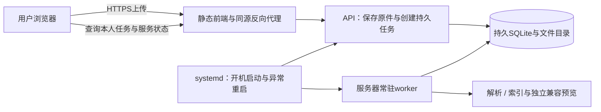

# 资料上传处理可靠性与供他人使用的部署

2026-10-23，M1-UPLOAD-RELIABILITY-19。先记录[契约19](../../contracts.md#m1-upload-reliability-19)及[交接020](../../../collaboration/handoff.md#h-20261023-zhy-020)。本页的systemd/Nginx文件是可审阅部署示例，尚未在Linux服务器安装、签发证书或正式上线。

## 为什么会一直排队

现场只读核对发现：test账户三份PPT的PARSE均QUEUED、attempt_count=0；前端和API仍在，独立worker已不在进程列表。恢复原worker后解析、索引和兼容PDF均成功，分别33/31/97片段。说明文件已保存，堵在“无人接手处理”，不是上传数据丢失。缺少退出时日志，不能确认旧worker是被关闭终端、会话结束还是异常终止。

旧开发脚本只把worker放到后台，缺少退出重启；API的/health只检查数据库，页面又只有排队状态，用户因此无法区分正常等待与处理服务未运行。

## 本轮实现

- development下API生命周期默认托管worker；HUSTUDY_WORKER_AUTOSTART可显式开启/关闭。production默认外部管理，不把API进程数当任务处理进程数。
- 同数据库/存储的OS锁防止重复常驻worker，锁由进程退出释放；本机小型原子心跳文件与锁共同判断服务状态。心跳不入业务表/备份，路径/PID不对外返回。
- 托管worker退出后1/2/4/8/15秒有界退避重启；API退出只清理自己创建的worker，已存在的外部worker不被接管后误杀。POSIX下托管子进程组一起清理；Windows进程树/真实设备须另验。
- 常驻worker的兼容预览独立执行道最多同时一项；解析/索引不必等长Office转换。原claim、租约、尝试次数、取消与迟到结果检查保持；run_once/drain_jobs和--once保留。
- 上传区正常连接时不显示维护提示或刷新按钮，异常时显示认证处理服务状态，待处理时每3秒轻量复核；GET错误停止自动复核并允许显式刷新，401让出重登。原件可先保存，恢复后正常处理，不自动重新上传或用“已入队”冒充完成。

ready仅表示处理服务有有效锁/新鲜心跳，不是每份任务必成功、不代表没有其他任务或精确剩余时间。异常退出时原RUNNING任务仍受180秒租约与原次数预算约束，不直接重置；坏文件/无文本扫描PDF、资源不足、模型调用等仍按各自规则明确失败。此轮未声称实现全站任意并发SLA。

## 他人使用网站时

用户只打开域名、注册登录和上传。服务器维护者负责进程、证书、磁盘、日志与备份；不让每个用户运行脚本。新机器访问的localhost是那台机器自己，正式前端必须调用网站自己的API，而不是开发者电脑的127.0.0.1。

### 单机Linux部署示例

准备代码于/opt/hustudy、受限服务账户hustudy、持久目录/var/lib/hustudy及配置/etc/hustudy/hustudy.env，目录权限按该账户配置。依赖沿项目锁文件安装；兼容PDF需另装LibreOffice，原格式阅读无需它。

1. 复制[环境模板](../../../deploy/hustudy.env.example)，填写自己的强随机JWT密钥、域名和绝对数据路径；配置文件仅管理员/服务账户可读。不复制开发机凭据。服务器设置production和WORKER_AUTOSTART=false，由外部守护统一管理。
2. 构建静态前端：`VITE_API_BASE_URL=/api/v1 npm run build --prefix frontend`。未显式配置时生产构建也已默认同源/api/v1；显式命令避免遗留本机配置覆盖默认。每次替换前端配置需要重新构建，不能用5173开发服务充当生产站点。跨电脑账号/已有test迁移见[集中数据说明](cloud_accounts.md)。
3. 审阅并按实际路径安装[migrate](../../../deploy/systemd/hustudy-migrate.service)、[API](../../../deploy/systemd/hustudy-api.service)、[worker](../../../deploy/systemd/hustudy-worker.service)三个unit。migrate先完成再启动API/worker，避免首次建库并发迁移；升级时先停服务/备份，重新执行迁移服务后启动。是否开机启用由服务器维护者实际执行。
4. 根据真实域名/证书审阅[Nginx示例](../../../deploy/nginx/hustudy.conf)，TLS证书需实际签发。/api保留原路径转发到本机API，前端同源访问；数据目录不配置成可公开静态目录。每个文件请求30MiB加multipart头，代理限制示例35MiB；批量仍逐文件上传，应用的20份/100MiB规则保持。
5. 管理员验证：`systemctl status hustudy-api hustudy-worker`，`journalctl -u hustudy-worker`；API/数据库的/health与登录后的/api/v1/processing/status分别监测。worker退出73表示已有锁持有者，示例不靠重启循环制造重复worker，应核对配置。
6. 用验收账户从另一台电脑真实上传四格式，核对原件保存耗时、排队耗时、解析/索引/转换耗时及错误提示；再做受控崩溃/重启、来源撤权、完整备份恢复与并发测试。只在隔离部署执行故障注入。

这是单机小规模部署准备：SQLite与文件目录需要同机持久磁盘，不把同一SQLite文件跨多机网络盘共享或每台机器各自一份运行库当成已支持的集群。扩大用户量前，先按实际文件大小/页数、同时上传量与AI负载压测，再决定数据库/存储/任务分发的扩展；本轮不增加Redis、消息队列或新依赖。

API之外的AI/OCR等既有任务仍有自身预算和处理耗时。此轮主要隔离Office兼容转换，不宣称所有任务资源竞争均消除；高负载下的公平调度、资源配额和容量另行验收。

进程启动、重启、资源与多进程关系参考[FastAPI部署概念](https://fastapi.tiangolo.com/deployment/concepts/)；systemd故障重启与退出码规则参考[官方service手册](https://www.freedesktop.org/software/systemd/man/latest/systemd.service.html)。产品实现独立，不把API workers直接等同本项目资料worker。

## 验证记录

最终后端全量466通过、2个私有样本跳过（103.79秒）；新增6项覆盖默认开发/生产配置、GET认证与零写入/路径PID白名单、锁/过期/损坏心跳/跨进程重复、托管退出退避/外部实例不误杀、慢预览时新资料仍解析索引与取消租约、真实API自动启动/崩溃重启/重复退出73/后续上传/正常关闭释放锁。POSIX生命周期测试在Windows显式待验，不假称已验证Windows进程树。

真实子进程隔离专项另复核6项通过（15.10秒）；自制两页PPT从上传至解析/索引成功约0.86秒，该测试关闭LibreOffice，不包含兼容PDF耗时，不是大文件/并发SLA。前端27文件170单元与类型/生产构建通过；全后端Ruff、临时迁移无漂移、安全Markdown/AI显示及开发脚本语法检查通过。无新schema/迁移/依赖。

新增8项Chrome/WebKit上传专项全通过（32.6秒）；扩大52项四格式阅读/截图/长PPT/资料检查/原任务恢复/来源与草稿全通过（5.6分钟），合计60个不同场景。首次42项运行中24通过/3个新脚本等待错误/1中断/14未执行；原因是测试在页面尚未挂载时直接判定目录不可见，误点桌面隐藏按钮。补等待挂载并正确查找折叠内容后，上述8+52全部复验通过，保留原业务断言，不按旧中断数量充当完成。重复不累加。

5173与8000健康只读核对均200，新接口公开定义已加载、未登录请求401，日常本机处理服务ready。原test三份PPT维持正常成功，不为测试另建日常对象。所有故障/并发/崩溃验证使用临时数据库/存储、自制小PPT/文本和模拟转换，不调用真实模型。Linux/systemd/Nginx模板未实际安装/启动/签发证书，告警与真实容量/实机/成员接收待验。
