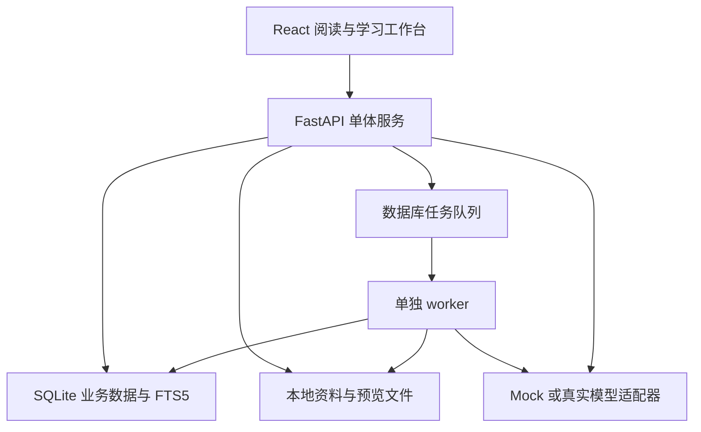

# Hustudy：产品主方案与实施路线

## 2026-10-19 M4题库抽题变更

按用户新要求，练习来源改为用户上传题库；自动规则识别单选四选项、填空和解答，人工校正/确认后按知识标签随机抽取，不调用模型生成练习。选项重排同步答案；唯一填空精确自动批改，非唯一填空交卷后自评；解答仅检查提交。此要求覆盖历史三模式AI拟卷/AI主观评分的日常练习入口；统计快照/STALE、标签合并、资料矩阵、拆合/去重与复习改期已补齐；真人/跨端验收及签收仍保持待验。

## 2026-10-16 M2继续推进（最新要求）

用户授权M2不再按轮换日期刻意分段，能独立交付的P0持续提前完成；日期仅作团队协调，不作为停工条件。当前已接入真实三模式/三题型候选、固定自制报告/题目演示、精确片段、问答历史与错误细分。M4正式章节映射/试卷集成、M1教师标注和M4完整确认映射/统计契约仍为真实依赖；学科质量、实机和签收需要实际验收。当前状态见docs/gcx/m2_plan.md及candidate_acceptance.md（相对本项目根）。以下保留前一切片和历史进度，不以旧“待后续”覆盖当前结果。

## 2026-10-16 当前协作变更

用户确认：gcx=B/M2，xtc=D/M4，fzk=M3、zhy=共享层/M1。gcx开发时段为10月16–17日、10月24–25日、11月1日；xtc使用原gcx时段。11月5–6日完善网站与汇报。当前使用GitHub网页手动上传，不要求本地Git或新建Python环境；历史分支/角色描述保留为当时记录。当前唯一分工见collaboration/roles.md。

本轮M2-STUDY-REPORT-01由Codex辅助gcx实现真实章节报告，覆盖预览/确认/任务/结构化讲解/例题/自测/引用/笔记草稿/历史。详见docs/gcx/m2_plan.md和docs/gcx/study_report_acceptance.md；M4真实题目候选、教师/真题标签与完整学科质量验收仍待后续，不标整个M2或P0完成。

2026-10-13 协作记录补充：成员缩写 zhy/xtc/fzk/gcx 与现行 A/M1、B/M2、C/M3、D/M4 对应。`collaboration/` 与 `docs/` 各设四个同名目录，分别维护个人进度、功能与优化证据；根级公共契约/操作/集成文件保持统一。持续变更交接见 [handoff](../collaboration/handoff.md)，规则见 [AGENTS 第 20 节](../AGENTS.md#20-四人文档隔离与统一交接规则)。此项仅调整文档协作，不扩大产品需求或预填成员实验结果。

## 1. 已确认事实与设计假设

| 项 | 内容 | 依据与状态 |
|---|---|---|
| 名称 | Hustudy | 用户已确认 |
| 类型 | 工具类 | 用户已确认；适配附件工具类选题 |
| 开发团队 | 4 人 | 用户已明确四人姓名及队长身份；T1给出B/C/D条件意见，完整范围和工期决议待补 |
| 核心功能 | PPTX/PDF/DOCX 资料阅读与检索、AI 知识点讲解、笔记/资料/图片交叉引用、历年真题考点分析与模拟题生成 | 用户已确认 |
| 当前作业 | 需求分析、AI 协作记录、人工核实说明；个人提交 | 附件明确要求 |
| 架构、指标、规模 | 见下文 | 设计建议；附录G有局部运行证据，I1有用户问题定性支持，完整规模/性能/质量仍待验证 |

本文继承 StudyLens 的资料—理解—练习—复习闭环；本版将 DOCX、图片引用与真题分析升级为首版核心。首版优先解决大学生专业课和期末复习；考研考公信息聚合是后续扩展，不与核心功能抢工期。

## 2. 产品定义与价值

Hustudy 是把课程 PPTX/PDF/DOCX、个人笔记、图片和历年真题连成一体的 AI 学习平台。学生可以在文档旁边整理笔记，追溯每段解释的来源，再按照自己设置的考试要求生成模拟卷，把错题重新关联回原始知识点。

价值需要通过试用验证，不直接承诺提高成绩。拟验证的改进包括：减少寻找原文与切换文件的时间、降低笔记和资料脱节、让模拟练习覆盖指定章节、为错题提供可执行的回看和复习入口。

NABCD：

| 维度 | Hustudy 的设计 |
|---|---|
| Need | 资料分散、笔记孤立、通用 AI 难追溯出处、临近期末缺少符合课程范围的练习；作者已记录2026-10-13访谈五位学生、匿名编号及课程使用同意，I1给予定性支持，不代表总体普遍性或产品效果已验证 |
| Approach | 文档定位 + 稳定引用 + 笔记反向链接 + 基于个人资料的 AI 分析 + 蓝图约束出题 |
| Benefit | 用户围绕一门课程完成阅读、整理、提问、练习、纠错，不必手动维护多套来源关联 |
| Competitors | 网盘、Markdown 笔记工具、通用问答与题库是比较维度；实际竞品功能需独立核实，不能声称它们一定缺少上述能力 |
| Delivery | 先用自制或获授权的一门专业课资料开展试用，提供本地启动包、使用指南和演示视频 |

## 3. 代表性使用流程

学生新建“计算机网络”课程，导入课程 PPTX、PDF、DOCX 和 Markdown 笔记，以及三份年份已确认的历史试卷（演示用自制样例）。在阅读 TCP 章节时，把第 12 张幻灯片的原文引用插入“拥塞控制”笔记，并链接到“流量控制”笔记。

学生问“这两个概念的对象和触发条件有什么区别”，AI 仅在当前课程范围检索，回答显示引用入口；资料没有支持的结论标为证据不足。

系统拆题供用户校正，将“拥塞控制”真题映射到相关课件页与笔记，显示题型、年份分布和资料缺口。学生从这些已确认数据提议的蓝图开始修订。

考前创建蓝图：20 道选择题，每题 2 分；4 道简答题，每题 15 分，总分 100；指定章节覆盖和基础/应用难度标签。系统验证章节分配合计 24 题，再生成草稿。用户审阅后开始作答，客观题自动评分，主观题给出 rubric 和建议分。错题可以跳回相应 PPT 页和笔记，并加入次日复习。

数字仅为场景样例，不是所有课程默认题型。不能把以往考试样本统计出的分布解释为教师下一次考试的概率。

## 4. 系统模块与首版范围

| 模块 | P0 首版 | P1 增强 | P2 后续 |
|---|---|---|---|
| 课程资料 | 课程管理、PPTX/PDF/DOCX/MD 上传、解析、状态、阅读定位、删除 | 资料版本差异、扫描试卷 OCR | 旧 PPT 转换、视频字幕 |
| 个人知识库 | 课程分类、标签、全文检索、可校正 Topic 与考点资料映射 | 语义搜索、自动资料对齐、图谱展示 | 跨课自动知识图谱 |
| 笔记双链 | Markdown 编辑、自动保存、笔记双链、资料/图片引用、含附件导出 | 图谱展示、模板、批量整理 | 多人实时编辑、移动同步 |
| AI 学习 | 带来源问答、重点/难点/考点及其依据、学习顺序、例子与自测、保存结果 | 反向费曼、迁移问题、跨资料比较、复习卡片 | 语音讲解、多模态图表理解 |
| 真题分析 | 元数据、AI 拆题与人工校正、考点映射、历年分布、资料缺口、蓝图提议 | 扫描 OCR、跨卷近重复识别 | 外部题库自动抓取 |
| 模拟考试 | 历史蓝图/考点变式/薄弱项练习、来源校验、审阅、作答恢复、判分 | 语义去重、个人自适应难度 | 复杂自动阅卷 |
| 复习管理 | 错题关联、手动复习时间、今日任务、反馈 | 间隔复习、薄弱章节与学习债务排序 | 外部消息提醒 |
| 工程保障 | 用户隔离、可恢复备份、错误状态、测试、说明书 | 更大规模性能优化 | 云端多人服务、第三方登录 |

P0 不承诺自动解析图片内公式、扫描件 OCR 或动画；扫描 PDF 可查看原页并人工补录题目，来源标为人工转录。PPTX 原始排版通过转换 PDF 阅读；不能转换时回退为显式标注的文本视图。旧二进制 `.ppt` 要求用户先另存 PPTX/PDF，不能用 python-pptx 直接解析。

## 5. 界面规划

| 页面 | 主任务与重要交互 |
|---|---|
| 课程首页 | 新建课程、资料与笔记数量、最近阅读、今日复习；无资料时给上传入口 |
| 资料中心 | 四格式资料及图片、进度、错误及重试、标签筛选、下载原件、删除确认 |
| 阅读工作台 | 左侧目录与页码，中间文档，右侧笔记/AI；选择文本→插入引用→点击返回原文 |
| 笔记页 | Markdown/图片编辑与预览、保存状态、来源、出链与反链、冲突处理 |
| 搜索页 | 按课程和类型过滤，显示命中片段；关键词/语义模式有真实状态标识 |
| 真题中心 | 年份/来源、题目拆分校正、考点映射、历史分布、课件匹配与缺口 |
| 知识点报告 | 重点/难点/考点的依据、学习顺序、例题、自测、保存为笔记草稿 |
| 模拟卷蓝图 | 题型、题数、分值、章节整数分配、难度标签、时长；即时显示约束冲突 |
| 审阅与考试页 | 草稿答案审阅；考试中保存恢复和计时；提交后显示答案与反馈 |
| 错题与复习页 | 按章节和错因过滤、回源阅读、再练、完成复习 |
| 设置 | 模型模式、资料发送确认、备份恢复、账号时区、使用帮助 |

在原型阶段覆盖空状态、加载、失败、删除引用、网络中断与无模型配置，避免只画成功页面。

## 6. 技术架构与实现理由

本地部署默认服务绑定回环地址；局域网试用需要明确开放地址、登录与备份安排。阅读、笔记、关键词检索不依赖模型；真实远程 AI 依赖网络与费用配置。Mock 提供有标记的演示结果，不适用于任意上传文档的真实分析。

四人团队优先使用 SQLite 与单 worker，把集成成本放在来源、笔记和试卷的一致性上。向量索引仅为可重建检索副本，业务事实由关系数据库保存；备份包含原始资料、版本、笔记、引用、答案与复习任务，不强制保存可重建向量索引。

## 7. 核心数据关系

| 对象关系 | 设计含义 |
|---|---|
| User → Course → Document → DocumentVersion → Chunk | 资料有归属和不可变版本，定位与来源稳定 |
| Note → NoteLink → Note | 显示名可变，UUID 目标不变；反向链接自动生成 |
| Note/AIResult/Question → Citation → Chunk | 相同引用结构贯穿阅读、分析和练习 |
| ExamBlueprint → ExamPaper → Question | 蓝图约束先校验；题目生成后快照保存 |
| ExamPaper → ExamAttempt → AttemptAnswer | 题目答案在提交前不会传给作答接口 |
| AttemptAnswer → Mistake → ReviewTask | 错题来自真实提交，幂等创建复习入口 |

用户笔记默认是个人观点或记录。笔记中 AI 草稿或未核实内容不能自动成为出题唯一事实依据；可引用原始课程资料，或由用户明确标记笔记已审阅。

## 8. 三个重点工程机制

### 8.1 可追溯的双链知识库

资料引用和笔记链接分开建模。资料引用保存版本、页/幻灯片/标题、原文摘录；笔记链接保存 UUID 和显示名。点击笔记回到原文，阅读页也能展示引用该处的笔记。资料更新保留旧引用版本；删除目标显示失效，不悄悄重定向。

这是可演示、可测试的产品差异点；“同类产品没有”须另做竞品核实。

### 8.2 证据约束 AI 分析

先查授权范围，再检索原文，限制上下文预算，模型只能输出有效来源 ID。后端逐项检查引用；无依据时说明不足。P0 中文关键词搜索足以完成起步闭环；P1 采用关键词和语义检索的 RRF 融合，避免原方案未经归一化的固定加权分数。

检索实验使用人工标注至少 30 个课程查询及正确来源，报告 Top-5 是否包含至少一条正确来源的比例。v2补充最低阈值≥80%，且不低于相同标注集的关键词基线，见需求附录A。引用结构有效不等于语义正确，后者另做人工抽查。

### 8.3 蓝图约束的模拟卷

蓝图输入：章节及题数、题型及数量和分值、基础/应用等难度标签、考试时长、资料范围、可选参考样卷。

约束示例：`sum(type.count * type.points) == total_points`；章节题数之和等于题型总题数。P0 为每题分配一个主章节，可附其他涉及章节。跨章节分值约束或复杂比例冲突留到 P1；输入不可满足时拒绝生成并指出冲突。

模型负责生成候选题，程序负责整数配额、引用、选项、标准化重复、预算和状态。用户审阅后才能进入正式模拟。主观题按 rubric 建议评分，用户可以修正；不承诺 AI 判分等价于教师评分。

## 9. 四人分工与任务

下表及新增任务说明保留v1的详细任务与历史分配，便于追溯。本版现行模块边界为A=M1与共享层、B=M2 AI、C=M3笔记、D=M4；旧分配不继续作为当前主责。T01–T44任务内容均保留，编号到现行负责人映射见第13.4节与追踪矩阵，条件意见见AI记录第8/10节。

| 角色 | 主责 | 建议任务编号与内容 |
|---|---|---|
| A.张昊轶 | 基线、数据、四格式解析、图片存储、集成 | T01 工程初始化；T02 认证隔离；T03 课程；T04 迁移契约；T05 上传校验；T06 四格式解析；T07 worker 恢复；T08 PPTX/DOCX 预览与定位；T09 集成与数据测试 |
| B.向天晨 | 阅读、笔记图片双链、真题校正界面 | T10 阅读布局；T11 页码定位；T12 Markdown 编辑；T13 自动保存冲突；T14 笔记双链；T15 资料/图片引用；T16 笔记导出；T17 备份恢复界面；T18 原型与交互测试 |
| C.付振琨 | AI、真题拆分映射、检索、出题 | T19 中文检索；T20 Provider/Mock；T21 发送确认；T22 引用校验；T23 知识点与重难考点报告；T24 课程问答；T25 候选题生成；T26 候选校验修复；T27 AI 评估与异常测试 |
| D.高长鑫 | 历史统计、考试、复习与交付 | T28 蓝图；T29 审阅试卷；T30 作答保存；T31 规则/建议判分；T32 错题；T33 今日复习；T34 反馈与试用流程；T35 E2E；T36 用户指南与发布包 |

新增任务：A 主责 T37 DOCX block 定位、T38 图片附件/引用存储；B 主责 T39 真题校正界面、T40 考点矩阵与回源界面；C 主责 T41 真题分层拆分、T42 Topic 归一与证据映射；D 主责 T43 历史统计与缺口、T44 三种生成模式与双来源结果集成。C/D 共同测试出题，A/B 共同验证图片导出和定位。

每个任务拆为需求 ID、输入输出、验收、主责、评审者、状态和证据链接。

## 10. 分阶段实施与关口

保留原有Phase 0–8及通过关口。顺序是交付计划，不是完成进度；工期依据第13节按成员可投入时间计算，不能以阶段列表代替容量证明。

| 阶段 | 内容 | 通过关口 |
|---|---|---|
| Phase 0 | README、前后端基线、锁文件、数据库、Provider 接口、测试资料 | 健康检查、迁移、前端构建与 Mock 能运行 |
| Phase 1 | 用户、课程、授权 | 两账户访问隔离；重启保存课程 |
| Phase 2 | 四格式上传、解析、阅读、定位、worker | DOCX 段落表格顺序；PPTX/DOCX 预览成功或明确文本降级；失败可恢复 |
| Phase 3 | 笔记、图片、引用、反链、导出 | 回源、重命名、失效、并发冲突全部可复现 |
| Phase 4 | 中文搜索、问答、知识点报告、保存结果 | 有证据/缺证据/模型失败三条路径；真实模式有发送确认 |
| Phase 4A | 真题导入、拆题校正、Topic 映射、历史统计和缺口 | 三份自制样卷，校正可用；未知数据不补造；统计可手工复算 |
| Phase 5 | 三种模式、蓝图、生成校验、审阅、作答判分 | 数量分值精确；无答案泄露；提交幂等与恢复 |
| Phase 6 | 错题、手动复习、备份恢复、反馈 | 错题回源；时区任务正确；备份完整恢复 |
| Phase 7 | E2E、性能测试、用户审阅、说明与发布包 | P0 需求逐项有证据；未达标项如实列出 |
| Phase 8（可选） | 语义检索、资料对齐、费曼、间隔复习 | P0 无回归后再单独验收 |

## 11. 完整功能设计

### 11.1 AI 阅读：从总结变成可学习的讲解

每份报告使用固定教学结构：

1. 本章学习目标与前置知识；
2. 知识点分层目录和概念关系；
3. 重点及理由、难点与突破步骤；
4. 已观察真题考点与教师标注，单列 AI 推测；
5. 概念→原理→例子→对比→易错点；
6. 三到五个自测问题和复习建议。

用户选择“快速预习/系统自学/考前复习”调整篇幅与练习数量，事实仍来自同一资料。保存为笔记时先创建可编辑草稿，不直接覆盖个人笔记。公式排版可以用 Markdown 数学扩展；解析不可靠的公式标记待核实，不让模型猜符号。

学习报告有自己的 scope 与来源快照。报告生成前可选择课程、章节、笔记是否作为补充资料；AI 草稿默认不能反过来充当事实证据，避免循环引用。

### 11.2 媒体化笔记与双链

用户可在笔记中插入自己上传的图片、课件截图和结构化引用，并查看所有引用某张图/某份资料的笔记。图片 caption/alt、标签和来源可搜索；图片内部文字未识别前不声称可全文搜索。

Obsidian 是交互参考：借鉴内链、反链与附件嵌入的用户体验，不宣称兼容其全部插件。Hustudy 通过 UUID 抵抗重命名与目录变化，并增加可定位的课程资料引用。导出支持：

- 单笔记 Markdown；
- 知识库 ZIP：Markdown + 相对链接图片 + 来源清单；
- 完整账户备份：包含资料、版本、试卷与学习记录。

这三个出口用途不同；普通 Markdown 导出不保证可在外部还原 AI、考试状态和动态来源跳转。

### 11.3 真题研究工作台

步骤：选择课程 → 导入试卷与可选答案 → 设置年份/版本/来源 → AI 按题号与子题拆分 → 对照原文校正 → 提取考点/题型/分值/能力要求 → 匹配课件与知识点 → 人工确认映射 → 历史分析。

支持没有答案的试卷。此时参考解答是 AI 草稿，不能标为标准答案。跨页题、图表题与一题多问保留多来源；图中文字无法解析时显示需补录/OCR，用户可以人工补录并确认。

报告展示：

- 本次分析包含几份卷、哪些年份、多少道已确认题；
- 考点涉及题数、出现年份、已知分值分布；
- 题型和能力标签，如记忆/解释/应用/推导；
- 每个考点对应的课件、笔记、图片、历史题；
- 当前导入资料未匹配的考点；
- 未作答/已练习/错题较多等个人状态。

“历史频率”只描述用户导入样本。课程大纲改变或年份不明时提示统计范围；A/B 卷、重复扫描件等由用户确认独立性，不凭文件名自动当新样本。

### 11.4 考点矩阵与资料缺口

矩阵的行是课程 Topic，列包括历史年份、课件定位、笔记、图片、练习和错题。点击一个单元格回到真实对象。没有匹配显示“当前已导入资料未匹配”，没有作答显示“尚未评测”，避免误判未讲授或未掌握。

这是 P0 的一张关系表与矩阵 UI，无需先建设复杂知识图谱。P1 可加关系图、先修依赖和跨课链接，但基础关系仍保存在 SQLite。

### 11.5 三种模拟题模式

| 模式 | 输入 | 输出与约束 |
|---|---|---|
| 同考点变式 | 已确认真题 + 课件/已审阅答案 | 保留考查目标，改变数值、条件、情景或问法；答案重新推导，不能只改题干 |
| 历史蓝图模拟 | 历史统计 + 用户确认的题数/分值/章节配额 | 匹配试卷结构和知识范围，出新题；显示题型及难度标签而非承诺真实考试难度 |
| 薄弱项专项 | 本人已提交答案与错题 + Topic | 对真实错误关联的概念追加基础题/迁移题；没有作答数据时用用户自选弱项，不虚构掌握度 |

同一试卷可混合模式，但每题记录模式。新题界面显示“设计参考真题”和“答案知识依据”两组来源。题数、分值、章节配额由代码验证，来源与学科正确性仍需要人工评估。

不要只模仿原题表面句式。可以保持“拥塞窗口变化”的目标，改变网络条件和已知值，再要求学生解释变化原因。计算题的公式与结果应有程序校验或明确人工审阅入口；开放题用可编辑 rubric。

## 12. 核心数据、计算与可复现评价

新增对象与状态：

- Topic/TopicSource：名称、别名、章节、资料版本与证据；
- Asset/AssetReference：图片、说明、来源、引用关系；
- PastPaper/PastQuestion：原卷/原题、年份、题号、答案来源、分值、草稿/确认状态；
- QuestionTopicMapping：主/次考点、证据与确认状态；
- ExamAnalysisReport：分析范围、版本快照、统计和缺口。

历史统计建议使用可复算定义：

- 题目涉及率 = 涉及考点 t 的已确认题数 / 本次已确认题数；多标签涉及率加总可以超过 100%。
- 年份出现率 = 涉及 t 的已知不同年份数 / 本次已知不同年份数；年份未知的卷单列，不计入此分母。
- 分值占比 = 主考点为 t 的已知分值之和 / 统计题目的已知分值总和；未知分值不补 0，显示未知占比。
- 个人错题率 = t 对应已判定作答的错误数 / 该范围已判定作答数；无记录显示 unknown，不做零错误推断。

分值总和为 0 或分母为空时显示不可计算。小题拆分后只能在计分叶子分配分值，不能父题和子题同时累计。

评价不是拿 AI 输出再问同一个 AI“是否优秀”。采用人工标注小样本：

1. 至少三份自制/获授权的试卷，含跨页、未知分值、无答案、重复卷等情况；
2. 至少 30 个原题考点映射，以人工结果对照；
3. 至少 20 道新生成题，分别审阅来源、正确性、目标考点与是否实质重复；
4. 对比人工查找/整理和 Hustudy 流程的完成时间、定位错误和修正次数；样本小只做描述性结果，不宣称统计显著。

这类证据有助于课程评审的可验证性与真实性，但不能保证具体分数。

## 13. 范围、容量与任务分工

### 13.1 估算口径与容量

48 项父功能需求中 P0 为41项、P1为7项（31/32/33/34/46/47/48）。需求条数不是工作量。以下为设计估算，不是已投入工时或成员承诺；已有代码未逐项验收，不能从剩余工作量中直接扣除。

以下保留原估算作为比较基准，已被新成员投入信息否定为可直接承诺的工期；修订分析见13.5。原假设以12个开发周、每人每周12小时计算：4×12×12=576人时。预计工作460人时，预留116人时（总容量20.1%），含学习、修复及集成不确定性。12周不等于12次课程：课程有8个教学关口，需按教师实际日期映射，不能假定每次课恰好间隔一周。

| 工作包 | A | B | C | D | 合计（人时） |
|---|---:|---:|---:|---:|---:|
| 基础层、契约、安全与迁移 | 28 | 4 | 4 | 4 | 40 |
| 四格式、图片存储、预览、检索 | 42 | 6 | 10 | 2 | 60 |
| 笔记、引用、冲突、导出 | 8 | 2 | 44 | 2 | 56 |
| Provider、问答、报告、候选校验 | 4 | 46 | 6 | 8 | 64 |
| 真题拆分校正、映射、历史统计 | 4 | 16 | 8 | 34 | 62 |
| 蓝图、三模式、审阅、作答判分 | 4 | 12 | 6 | 42 | 64 |
| 错题、复习、备份与反馈 | 12 | 2 | 16 | 14 | 44 |
| 模块测试、集成、试用和说明 | 18 | 12 | 16 | 24 | 70 |
| 预计合计 | 120 | 100 | 110 | 130 | 460 |
| 各自机动额度 | 24 | 44 | 34 | 14 | 116 |
| 个人容量 | 144 | 144 | 144 | 144 | 576 |

D负载最高，真题候选算法由B提供，C提供校正界面通用编辑组件，A提供任务/存储；D保留业务确认与统计主责。表中已计入协作与测试，不额外重复相加。四人按接口协作，不跨模块直接读写表。

### 13.2 使用价值与投入权衡

| 能力 | 预期频率（待访谈验证） | 保留 P0 的理由 | 限制投入的方式 |
|---|---|---|---|
| 阅读、引用、笔记、搜索 | 日常高频假设 | 是其余闭环的基础 | 四格式正文与预览降级，不自研排版引擎 |
| AI讲解 | 学习阶段中频假设 | 解释与资料证据绑定 | 单Provider接口、确定性Mock、无语音 |
| 真题拆分/映射/统计 | 考前集中假设 | 用户明确的核心差异化要求 | 人工校正，章级配额，确定性关系表，OCR后置 |
| 三模式模拟与错题 | 考前中高频假设 | 验证从资料到练习的闭环 | 仅单选/判断/简答，主观题辅助评分 |
| 反馈 | 低频假设 | 课程试用证据且实现轻量 | 单表文字及可选评分，无复杂运营后台 |
| 备份、安全、引用失效 | 低频但损失风险高 | 防止个人资料与作答丢失 | 仅空账户恢复，不做复杂合并 |

优先级按闭环依赖、风险和明确用户要求综合判定，不按出现频率单独排序。P1/P2不消耗本表容量。真实模型的质量阈值必须另有真实运行证据，Mock只能验证流程。

### 13.3 实施依赖与退出条件

旧W1–W12按每人12小时/周假设编排，已不适合作为当前日历，删除该重复周次表。现行顺序以需求附录E的C1/C2/C3为准：共享契约→资料/引用稳定→笔记→来源AI与真题映射统计→拟卷作答→真实产品验收。原阶段通过关口仍有效，实际日期在实施前评审。

任一格式定位、授权或引用校验失败，或预计超出个人可用工时，即暂停相应集成并重估；阶段演示不能标记完整P0达标。本次个人需求分析提供范围和可行性判断，不要求先交付全部实现与测量数据。

### 13.4 任务兼容与责任

当前用户已明确：队长张昊轶(A)、向天晨(B)、付振琨(C)、高长鑫(D)。以下为模块任务基线。T1已提供B/C/D条件意见和每周时间；各项任务未逐一获得认可，A时间已补为8–10小时/周；完整范围及交期决议仍待补。

| 角色 | 模块/建议任务组（每人10组） | 保留旧任务编号 |
|---|---|---|
| A | A01环境、A02认证课程、A03迁移、A04存储Job、A05上传、A06解析、A07预览、A08索引、A09检查脚本、A10集成 | T01–09、T19、T37–38 |
| B | B01Provider、B02提示版本、B03上下文、B04问答、B05教学报告、B06标签依据、B07候选校验、B08任务预算、B09AI测试、B10使用说明 | T20–27；为T41–42提供候选接口 |
| C | C01编辑器、C02搜索界面、C03双链、C04反链、C05图片嵌入、C06Citation、C07导出备份、C08保存冲突、C09安全测试、C10阅读交互 | T10–18；为T39–40提供通用组件 |
| D | D01真题、D02拆题校正、D03Topic映射、D04统计缺口、D05蓝图、D06三模式、D07作答判分、D08复习、D09闭环、D10试用文档 | T28–36、T39–44 |

T01–44为历史细分工作，A01–D10为40个领取任务组，不重复计算成84项。T19从旧AI组归M1索引，T39–42业务状态归M4，B输出候选而不直接改真题；B/C较旧稿对调为当前M2/M3基线。建议评审轮换 A→B→D→C→A；每个模块自带测试，跨模块按共享契约评审。

### 13.5 根据成员回复重估容量与交付顺序

证据T1：A为8–10小时/周（记录日期2026-10-12，自行确认）；B/C各6–8小时/周，D为5–7小时/周（2026-10-13 QQ交流）。可持续周数和最终交期未定；以下按12周作敏感性分析，不把假设持续时长写成成员承诺。

| 成员 | 原预计工作量 | 12周容量区间 | 相对原工作量缺口（未含机动） | 判断 |
|---|---:|---:|---:|---|
| A | 120小时 | 96–120小时 | 0–24小时 | 上限仅覆盖预计工作，未含机动，不能默认兜底其他成员缺口 |
| B | 100小时 | 72–96小时 | 4–28小时 | 上限仍不足，须调整范围/工期/分工 |
| C | 110小时 | 72–96小时 | 14–38小时 | 自动引用降低操作负担，不能据此假定开发更快 |
| D | 130小时 | 60–84小时 | 46–70小时 | 主要瓶颈，应拆出候选算法和通用界面协作，但协作人也有容量约束 |

四人合计每周25–33小时，12周300–396小时。相比460小时预计工作缺64–160小时，相比原含机动的576小时情景缺180–276小时。因此不能写“按当前投入12周可交付全部P0”。原460小时本身也只是估计，后续需按实际任务记录校准。

若不转移任务、不缩范围，单看D的130小时在5–7小时/周下就需约19–26周；若20%容量留作机动，则需约24–33周。这仅显示瓶颈，不是新的全项目交期承诺。总工时充足仍不保证关键路径足够短。

建议顺序：

1. C1资料与笔记基础：四格式阅读/关键词检索、手动真题元数据、自动来源笔记/图片及已有对象备份；正式错题复习在C3交付，不在无作答时捏造错题。以附录E清单及对应TC验收。
2. C2来源AI与真题分析：选定片段解释、发送确认、结构化教学报告与草稿插入；真题拆题校正、映射/统计/资料缺口。FR-43先显示未作答unknown，FR-45先验分析任务。
3. C3拟卷作答与复习整合：蓝图、三模式生成、审阅/作答/评分、错题复习/反馈；补验FR-15完整备份、FR-43作答关联和FR-45生成任务，以及跨模块P0/NFR。仍需全部P0验收，不以前两切片替代。

当前交付范围提案已落到需求附录E的C1；团队仍需批准并决定：延长实际开发周期、在真实容量内调整模块任务，或正式缩减本次阶段交付范围。当前只优化顺序，不未经批准把DOCX、图片、拆题映射统计降为P1。B提出缩减AI及C提出块级后置的意见列为范围冲突，先保留可逆的UI简化与服务端契约，待决定后统一修改FR/TC。

### 13.6 访谈对产品取舍的实际影响

INT-01支持先检索、再整理真题/错题，AI使用以可信来源和可控外发为条件。笔记普通编辑不强制填引用，自动插入引用仍进行服务端校验；页级展示不等于底层放弃版本、chunk和摘录。保留教师标记/历史观察/AI建议区别，不把模型语气或排名分数变成“可信度”。

不新增社交排行榜、自动爬题、考点预测、视频时间戳等P0范围；移动同步维持P2，打印清单维持P1，备份保持P0。访谈“愿意试试”不等于NFR-09已通过，真实使用完成率和满意度仍需独立测量。原话、不同意见、来源限制与需求映射见 [AI协作记录第9–10节](Hustudy_AI_collaboration_and_verification.md#interview-analysis)。

### 13.7 容量回灌后的交付基线

现行逐项清单及推荐取舍统一以[需求附录E](Hustudy_requirements.md#delivery-slices)为准：C1/C2/C3=18/11/12项，合计41项完整P0；推荐先C1，作者最终判断见AI记录8.3，团队排期尚未批准。150/150/160人时是评审估算；12周不承诺完整P0，C1也受C的个人容量条件约束。教师日期、实际持续周数及任务调整待实施评审，不将13周算术参考写成已确认交期；FR-15/43/45跨阶段补验保持公开。

A在阶段排期锁定及下次教师评审前组织全员裁决（具体日历日期待教师安排），按需求E.2记录变更并同步AI记录8.4；未接受的范围以CR修订，不私自将DOCX、图片或真题统计降为P1。后续测量真实工时和失败修复成本后重估，不能把本估算写成实测。

### 13.8 本次实验与后续开发的边界

《需求分析文档生成》要求个人提交规格、真实AI协作及关键结论核实说明。当前C1方案和容量推导是个人分析提案，实际团队排期仍待实施评审；20条抽查、五人试用、性能和完整备份是产品后续验收，不作为本次必须先完成的交付。作者最终审阅、真实来源与状态准确性仍必须保留；具体评分依据见提交说明1节。

## 2026-10-13 工作台体验实施增量

本轮按现有能力增加课程内统一查找（资料原文与笔记分组）、搜索结果按指定版本/片段回源、首页笔记直达和五步使用指南。导航“笔记图谱”调整为“知识笔记”，避免将双链列表描述为已实现图谱。查找保留当前课程范围，不引入语义检索或新模型调用。手机 viewport、键盘入口和响应式界面作为共享体验基础。

宏观交付改按可靠性→阅读笔记→有据学习→真题练习→全链路验收分关口；具体依赖、负责人角色和风险见 [工作台体验与交付路线](../collaboration/experience_roadmap.md)。本增量不扩大 P0/P1 范围，不替代现有团队排期与需求验收。

## 2026-10-14 共享层与 M1 实施状态入口

已有不可变资料版本、四格式解析/关键词索引、独立worker、PDF按页/截图来源及人工补录；本轮 M1-ASSET-ORGANIZE-01 补图片名称/说明/标签、元数据查找/来源筛选/排序/分页、revision冲突本地保留。旧图片UUID/文件/版本来源与笔记引用不改，0007回填/中断回滚可重试。30项后端与共享检查通过，详细证据见[公共进度](../docs/progress.md)、[队长缺口分析](../docs/zhy/materialhub/materialhub_gap_analysis.md)与[交接](../collaboration/handoff.md#h-20261014-zhy-003)。Safari图片完整闭环、附件导出/备份、显式任务管理和完整P0仍待验收；本段仅同步实际代码状态，不改变需求优先级/排期，也不冒充其他成员工作或本人审阅。

## 2026-10-14 任务控制与验收增量

共享/M1的取消、恢复、UUID幂等重建及租约迟到保护已实现，失败/取消依赖不通过换新记录绕过预算；无新schema/迁移，不改M2–M4内部。35项后端与共享检查通过，Safari真实课件/状态/重建入口局部观察；完整任务交互、资料/任务分页、附件导出/恢复、压力/全资源验收仍待推进。详见[验收报告](../docs/zhy/materialhub/acceptance_2026_10_14.md)与[交接](../collaboration/handoff.md#h-20261014-zhy-004)，不扩大P1/P2或把局部通过写为全部完成。

## 2026-10-14 课程资料包与队长验收增量

M1-EXPORT-01交付课程原件/版本/预览/文本/确认补录/图片/来源ZIP和独立hash校验器，后台租约/预算/来源撤权，0008追加表；同时修复SQLite新Session租约恢复。40项测试/共享检查及Safari生成到实际下载/hash验证通过，M2–M4内部未改。资料包不含笔记/AI/考试等数据，不支持恢复；完整账户备份、环境/LO/资源压力/发布关口仍需完成。见[验收与队长十任务映射](../docs/zhy/materialhub/material_export_acceptance.md)及[交接005](../collaboration/handoff.md#h-20261014-zhy-005)，不扩大P1/P2或把局部交付冒充全部P0完成。

## 2026-10-14 共享课程整理增量

PLATFORM-COURSE-01落实正式A02的课程名称/描述/分类/标签整理、筛选及revision冲突保护；0009追加列，来源/笔记关系保持。43项自动检查通过；Safari自制课程/双标签页冲突实测，最终界面补丁部分复验待补。课程删除清理、资料/任务分页、完整恢复、环境/发布仍待验收，未扩大P1/P2或标全部P0完成。[验收](../docs/zhy/shared_platform/course_organization_acceptance.md)、[交接006](../collaboration/handoff.md#h-20261014-zhy-006)。

## 2026-10-14 基础验收与课程删除

PLATFORM-COURSE-DELETE-01补齐课程逻辑撤权、影响预览/revision/名称确认、模块同事务清理与失效来源保持；0010追加列。47项回归与共享检查通过，Safari预览保护通过，用户库没有执行删除。M2–M4适配仅生命周期/授权；标准JWT迁移、完整恢复/附件ZIP、真题统计与真实生成、性能/环境/完整E2E与发布仍待完成，未把自动通过写成全部P0完成。[验收矩阵](../docs/zhy/shared_platform/basic_acceptance.md)、[交接007](../collaboration/handoff.md#h-20261014-zhy-007)。

## 2026-10-14 智谱真实问答增量

用户指定GLM-4.7-Flash，M2-ZHIPU-QA-01交付后端配置/M1有界来源/不可变预览/明确确认/单次后台任务/JSON与原文校验/真实结果回源和冻结引用草稿，0011。67项检查与自制真实417tokens请求通过，Safari模式入口观察；政策细项与完整浏览器闭环待补。真实章节报告/M4生成未自动接入，其他P0与环境/性能/发布关口保持待办。[验收](../docs/zhy/integration/zhipu_qa_acceptance.md)、[交接008](../collaboration/handoff.md#h-20261014-zhy-008)。不记录密钥、不冒记xtc本人工作。

## 2026-10-15 用户原格式预览变更

M1支持PPTX/PDF/DOCX按源格式直接阅读：PPT按幻灯片，Word保留基础段落/样式/表格/图片，PDF按原页。Office原件本地浏览器隔离渲染，不再必须等待PDF转换；LibreOffice转PDF保留为明确的兼容预览/截图路径，正文引用仍按不可变版本与原定位。首版不含旧二进制.ppt/.doc、编辑和完整动画。该用户新要求覆盖早期“PPTX仅转PDF预览”的产品入口约定，技术/验收见公共contracts及zhy材料目录。

### 2026-10-15：全站电脑/平板/手机排布优化

用户要求整体字号更小、各模块排布合理并适配三类终端。共享层统一界面密度和导航，M1/M3目录窄屏折叠，M2/M4沿用共享网格重排；不改变四模块业务分工、引用或模型确认契约。触控热区/输入可读性与界面紧凑度同时保留。PLATFORM-RESPONSIVE-01和CR-PLATFORM-RESPONSIVE-01定义验收，浏览器尺寸模拟与真实用户/实机证据分列。
