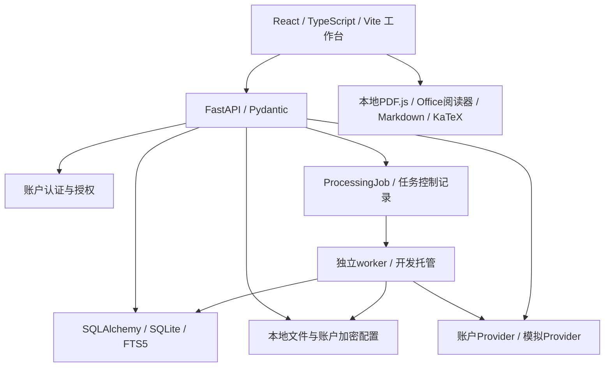

# Hustudy：网站设计主方案与小组实施路线

更新：2026-11-07。本方案以当前代码和已保存证据为依据，覆盖GitHub `main`基线`70096a8`及本地未提交修复。它描述现行产品及后续实施关口，不把最初设想或历史实验自动当作交付。实际操作见[user.md](user.md)，环境见[README.md](README.md)，人员进度见[协作说明](Hustudy_team_collaboration.md)。

## 1. 产品目标与需求边界

Hustudy帮助学生围绕一门课程，把分散的课件、理解、笔记、练习和复习连接起来。核心问题是“原文在哪里、理解根据什么、笔记如何复用、练习后如何回到薄弱内容”，而不是单独提供聊天窗口或文件列表。

| NABCD维度 | 本项目的具体选择 |
| --- | --- |
| Need | 面向大学课程的资料管理与复习；资料分散、来源难追溯和笔记练习脱节是需求假设，实际收益须用户试用验证 |
| Approach | 课程隔离、不可变资料版本、逐字引用、可编辑笔记、本人题库、错题回源和显式复习日程 |
| Benefit | 在同一工作台找回资料、解释、笔记和原作答，减少手动维护来源关系的负担；不承诺提高成绩 |
| Competitors | 与网盘、Markdown笔记、通用AI及题库工具按流程比较，不声称其他产品一定没有这些功能 |
| Delivery | 可复现源码、锁定依赖、启动/验证脚本、完整手册、自制案例和四方面汇报材料；公共部署另验 |

当前以个人账户和本人有权使用的课程材料为中心。多人共享课堂、教师后台、外部题库抓取、社交推荐、自动云同步不属于已交付范围。

## 2. 核心设计原则

1. **以课程组织，以原文为依据。** 每次读取/修改都验证账户与课程，来源不由文件名或标题猜测。
2. **版本稳定。** 新课件创建新版本；旧笔记、报告、练习保留原版本引用，不自动换成最新内容。
3. **用户确认改变事实。** 阅读不等于掌握，AI建议不等于教师要求，题目导入不等于核验，计划完成不等于答对。
4. **失败可见、恢复有界。** 上传/解析/索引/预览分开，错误不能变成空列表或成功；重试保留请求身份，401与未知结果不自动重放。
5. **AI按次选择。** 账户独立加密Key，预览目的地/范围后确认，限制时间、输出和修复次数；失败不放宽引用校验。
6. **共享体验。** 全站一套主题、路由、状态与离开保护；课程总览负责串联，业务事实仍由各模块维护。

## 3. 现行功能地图

| 层级 / 工作区 | 主要职责与输出 | 与其他模块的关系 |
| --- | --- | --- |
| 共享层 / 课程总览 | 认证、课程、主题、日程、学习记录、任务基础设施、备份、反馈与指南 | 聚合四模块真实元数据，回原UUID；不复制一套业务数据 |
| M1 MaterialHub / 资料阅读 | 上传、整理、不可变版本、解析/索引、原格式与文本/兼容PDF、人工补录、图片、查找/书签/版本对照、资料检查、范围导出 | 输出可授权读取的原文、定位、图片和引用；反查笔记/AI结果/知识标签/错题 |
| M2 AI Study / AI学习 | 原文检索、资料问答、学习报告、结构和引用校验、分批检查点与历史复用 | 消费M1正文；可选消费已确认的M3笔记补充和M4真题依据；输出可审阅结果及笔记草稿 |
| M3 NoteGraph / 知识笔记 | 管理/编辑/阅读、目录标签、双链反链图谱、引用图片公式、保存冲突、识别插入、笔记助手、导入导出/回收站 | 引用M1，接收M2草稿；通过只读适配向总览/检索/报告提供授权内容 |
| M4 ExamPilot / 真题与模拟卷、错题复习 | 题库/答案导入、校正核验、真题身份、知识标签/统计/资料缺口/蓝图、三种练习、判分自评、错题重做和计划 | 使用M1原题与讲义依据；冻结练习来源；向共享日程/记录和M2事实标签提供适配 |

辅助工作区：课程查找、API接入、备份与恢复、使用反馈、使用指南。独立“知识点学习”页面已移除，原相关流程由资料阅读/AI报告/题库考点承担。

## 4. 学习闭环与真实场景

### 4.1 无模型也能完成的基本闭环

在新课程上传自制传输层讲义，定位流量控制；保存带引用的笔记。把严格Markdown题库作为来源导入并核验，确认知识标签与讲义关系；抽题、保存答案、交卷，故意答错一题。打开错题回原题，回讲义补充笔记，安排明天复习并重做，最后导出与备份。[逐步案例](user.md#3-用示例走完一次学习闭环)。

### 4.2 有模型的数据库恢复技术案例

当前本机test账户已有“数据库系统设计”的《第十章》v1实测：问答选择第14–18页比较系统/介质故障；报告选择91片段可提取正文，按知识点解释、给出例题、自测及引用。用户核对来源后将单点或报告部分整理为笔记，再用已核验题库练习。

这是已有本机数据的实测说明，不是克隆仓库自带的课程。可用其他本人获授权资料复现流程；不能要求新用户获取私人文件或使用共享Key。

### 4.3 反馈如何回流

- 错题来源分为冻结原题出处和知识标签已确认的讲义关系；回源失败显示失效，不能猜一份新课件。
- 资料“学习关联”找回有效笔记、问答、报告、标签与错题；引用笔记列表按版本/片段分页，不把标签候选当成引用。
- 总览“继续学习”回原对象，“日程”显示真实待办；新增手动日程支持预习/报告整理等非错题任务。
- AI草稿采纳、笔记保存、题目核验、标掌握、计划完成是不同动作，分别保留状态。

## 5. 技术架构

采用模块化单体，减少四人团队部署与事务成本。前端使用React Router与TanStack Query统一路由/查询，不在模块另建互相冲突的导航。后台耗时任务以数据库记录、租约和状态提供可观察性；独立兼容预览执行道避免慢转换阻塞正文处理。

数据库是业务事实源，文件系统保存原件/图片/导出物；FTS5是可重建关键词索引。当前不启用向量检索，也不宣称PostgreSQL部署已验证。开发API默认托管worker；生产以外部守护管理并保留持久存储。

## 6. 核心数据与边界

| 数据关系 | 实际语义 |
| --- | --- |
| User → Course → Document → DocumentVersion → DocumentChunk | 归属、逻辑资料、不可变原件版本与定位片段 |
| ManualTranscript → 资料版本/位置 | 人工补录、确认/撤回、修订；不能与自动提取来源混淆 |
| Note → NoteLink → Note | UUID双链和反链；关系图谱只展示已保存的有效元数据 |
| Citation → 版本/片段/摘录 | 逐字quote、hash、偏移和定位校验；资料变更不重新猜测引用 |
| Asset / AssetReference | 图片及使用关系；普通上传图和有原页定位的截图不同 |
| RemoteQuery / AIResult | 发送范围、配置与提示词版本、成功/失败结果、私有分批检查点；部分结果不当完整历史 |
| PastPaper / PastQuestion / Topic | 题库身份、题目修订、题型/标签/讲义映射；与AI报告知识点区分 |
| ExamAnalysisReport / ExamBlueprint | 历史统计快照、STALE失效及练习约束，不是预测考试概率 |
| ExamPaper → ExamAttempt → 作答内容 | 练习与题目/来源快照、答案保存与交卷；核验前不进入正式练习 |
| Mistake → ReviewTask | 重做与日期计划；手动课程日程也复用ReviewTask，状态不代表掌握 |
| BankAnswerImport | 答案文件、题目修订、逐页结果、确认采纳；不解题、不改历史作答 |
| AccountArchive / PackagePreview / PackageImport | 完整备份与可选标准包的不同身份/事务策略 |

跨模块只读服务/适配负责元数据、来源与事实核验；一个模块不通过直接写其他模块表来完成捷径。公开字段和错误以[共享契约](docs/contracts.md)及[API](docs/api.md)为准，不在四份概述另建平行契约。

## 7. 关键工程机制

### 7.1 文件、来源与预览

原件先校验大小/格式/归属并原子保存，再异步解析和建索引。PPTX读取嵌套形状与表格，PDF读取正文页，DOCX按正文块，Markdown按文本结构。旧二进制PPT/DOC需外部另存，不通过改扩展名转换。

PPTX/DOCX默认原格式阅读，PDF直接原页阅读；Office兼容PDF显式发起并需LibreOffice。隐藏幻灯片纳入转换且核对页数；DOCX浏览器排版页不冒充原始Word页号。兼容失败不使已提取正文或原格式阅读自动失败。

### 7.2 AI证据与长资料

问答/报告先预览所选版本、片段、补充笔记、目的地和预算。默认课程检索有界；显式选定资料时可纳入≤400原片段/24万字符。长问答按8000字符/32来源单元检查相关摘录，再依据校验摘录统一回答；长报告按批独立教学生成，没有跨批AI全文融合。

JSON/schema、来源归属、逐字引用分别核验。结构修复授权0/1/2次，默认0，只修复安全有界的格式错误；生成与修复共享自首次派发起120秒窗口。检查点保留成功部分，明确续跑才开新窗口，修复总额度不重置。长报告依据已观察成功耗时保守判断剩余预算，不足时停止下一批派发。

精确复用要求来源/目标/配置等一致；相近问答/目标仅本地文字匹配最多3条，用户先查看原问题/目标与完整原结果，再明确确认。不能把推荐说成语义等价或把旧结果冒充新生成。

### 7.3 编辑、并发与安全恢复

笔记默认手动保存，可显式开启账户浏览器隔离的自动保存。revision防止覆盖；409基于共同版本逐段三方合并，只生成草稿，仍需保存。没有基线或超预算保留全文供人工核对。401原账户恢复、未知保存沿原请求身份核对，不能自动重放写入/模型请求。

Markdown不执行任意HTML，公式限制危险内容，Office iframe隔离且不传token。Key按账户加密、不进入前端持久存储/日志/备份。上传、ZIP路径/压缩预算、文件hash和批量关系校验防止越界，异常回滚并清理本次文件。

### 7.4 题库到复习

本地导入要求严格Markdown，其他格式通过明确确认的识别路径录入。新增题型仅选择题/解答题；AI用于已有内容转写、答案匹配、标签建议，不出新题、不猜未知答案。统一核验涵盖题干、答案、标签关联与插图。

随机练习、整卷练习、自行选题共享已有题目快照与作答流程。选择题随机模式可打乱选项并同步答案映射，恢复保持；自行选题保留题目顺序/选项约定。选择题有答案时自动判分，解答题提交后自评。原成绩、重做、每日目标和日程独立，不能互相替代。

### 7.5 三种包的不同目的

离线阅读ZIP携带资料或所选笔记及必要图片；标准`hustudy-package-v1`包可自选对象、依赖预览、事务导入，创建新UUID并可追加已有课程；完整账户备份保留业务UUID，只恢复到无数据/无冲突的空账户，不携带密码、Key或运行授权。

## 8. 界面和非功能设计

默认遵循统一远山蓝/云白/深色导航的课程工作台风格，允许主题、中文字体和12–18px字号调整。英文优先Times New Roman，实际字体取决于设备；代码/公式/原件保持自身排版。阅读与编辑内容有界，长正文局部滚动，手机导航抽屉和目录收拢保留挂载。

需要验证的非功能目标：处理进度可观察、查询真实分页、低磁盘明确507、限额和取消有效、错误不泄露敏感正文、批量失败不部分覆盖、跨课程/账户隔离、键盘与宽窄屏布局。性能必须注明样本/机器/并发/冷暖状态；不以一次快速响应承诺所有部署效率。

## 9. 四人核心模块与40项课程任务

现行分工：张昊轶zhy=A/队长/共享层+M1，高长鑫gcx=B/M2，付振琨fzk=C/M3，向天晨xtc=D/M4。B/D曾交换，历史目录中的旧描述不覆盖现行分工。下表是任务分解与当前实现对照，**不是40项正式签收表**。

| 编号 | 当前任务范围 | 交付/验收重点 |
| --- | --- | --- |
| A01 | 仓库、环境、锁依赖 | 干净环境可启动、配置不泄露 |
| A02 | 用户、课程、JWT | 账户/课程隔离、会话过期保护 |
| A03 | 数据模型、迁移、共享契约 | 迁移链/回滚边界、跨模块字段一致 |
| A04 | 文件存储、任务、worker | 原子保存、租约/取消/失败恢复 |
| A05 | 上传校验与资料整理 | 四格式/大小/权限、批量冲突与逐项结果 |
| A06 | 原文解析、补录、版本 | 定位顺序、确认/撤回、旧引用不漂移 |
| A07 | 阅读预览和来源 | 原格式/PDF/文本、截图/书签/版本对照 |
| A08 | FTS5及课程查找 | 真实分页、命中定位、版本/标签过滤 |
| A09 | 启动、检查、协作流程 | 脚本可执行；托管CI与评审证据另验 |
| A10 | 集成、总览、备份、发布准备 | 四模块闭环、共享外观/反馈/指南、正式发布关口 |
| B01 | Provider与模拟模式 | 账户独立配置、模拟明确标记 |
| B02 | 提示词与版本 | 结构约束、历史兼容、复用隔离 |
| B03 | 检索上下文与范围 | 所选资料/片段、覆盖和补充笔记 |
| B04 | 资料问答 | 相关依据、证据不足、长问答汇总 |
| B05 | 教学讲解 | 概念分组/关系、步骤、例题和自测 |
| B06 | 学习报告与标签 | AI建议、用户审阅及真实依据区分 |
| B07 | 输出/引用校验 | JSON/schema/伪引用、可选格式修复 |
| B08 | 异步与预算 | 分批进度、120秒窗口、显式续跑 |
| B09 | AI测试与复用 | 模拟异常、精确/相近推荐、真实质量独立审查 |
| B10 | AI说明与交接 | 范围/费用/模型/风险、M1/M3/M4集成 |
| C01 | Markdown编辑与阅读 | 草稿、撤销、分屏、目录/专注 |
| C02 | 目录、标签、检索/整理 | 导入、层级、批量与冲突 |
| C03 | UUID笔记双链 | 改名仍可定位、目标失效明确 |
| C04 | 反链与只读图谱 | 有效关系、筛选/聚焦、数量截断 |
| C05 | 图片与公式 | 授权图片、插入/撤销、公式安全 |
| C06 | 资料引用 | 逐字摘录、回原版本、失效与移除 |
| C07 | 导出、标准包与备份适配 | 依赖完整、选中范围、往返校验 |
| C08 | 保存与409合并 | 默认手动、可选自动、恢复/三方合并 |
| C09 | 安全与助手/识别 | 识别核对插入、AI预览采纳、权限/取消 |
| C10 | 交互说明和验收 | 窄屏/键盘、人工验收与集成记录 |
| D01 | 题库录入与原件 | 严格Markdown、多格式识别和ZIP安全 |
| D02 | 校正/答案匹配/核验 | 拆合、插图、未知答案、修订冲突 |
| D03 | 知识标签及讲义映射 | 层级/别名/合并、人工确认来源 |
| D04 | 历史统计与资料缺口 | 年份/样本、重复排除、STALE |
| D05 | 蓝图与约束 | 题型/标签/数量/分值、题库不足拒绝 |
| D06 | 三种现行题库练习 | 随机/整卷/自选，替代旧AI新题三模式计划 |
| D07 | 作答、判分、自评 | 不提前给答案、保存恢复、原快照 |
| D08 | 错题重做和日程 | 原成绩保留、计划/目标/掌握区分 |
| D09 | 全链路测试 | 大题/图/标签/交卷/回源及异常 |
| D10 | 反馈与展示 | 实例、用户试用、成员验收及讲解 |

## 10. 实施与协作路线

| 关口 | 顺序及产物 | 当前判断 |
| --- | --- | --- |
| 基础 | 环境→认证课程→迁移/存储/任务 | 已有代码与自动验证，目标机器复现需执行 |
| 原文 | 上传→解析索引→预览→定位/引用 | 已形成M1闭环，复杂真实文件需逐份核对 |
| 理解与表达 | M2问答报告与M3笔记并行，先定义来源/保存契约 | 已接通，教师强调上游仍缺 |
| 检验与复习 | M4题库核验→练习→错题→日程 | 已有主流程及新增答案/自选/日程，新增真人矩阵另验 |
| 系统集成 | 总览摘要/共享记录、资料反查、查找、包和备份 | 已有实现，正式联合签收不由自动测试代替 |
| 最终交付 | 全量测试、四人演示、代码量、试用、发布复现 | 本轮整理文档；尚不能推定公开上线和全部验收完成 |

集成关口沿用共享层→M1→M3引用/保存→M2结果/草稿→M4练习/复习→全链路；M2/M4可提前并行设计契约，但不得越过来源与保存边界。

后续首先做当前代码的完整回归与边界复验，再补M1教师标记、与M2/M4事实标签联合验收；之后安排至少5位真实用户试用，记录匿名反馈与改进，再处理生产运维；人数是待执行目标，不冒充已有评价。语义搜索、自动间隔复习、多用户实时编辑、云端服务扩展作为独立立项，不为丰富功能而破坏现有闭环。

## 11. 最终验收四方面

| 方面 | 要展示的实际证据 |
| --- | --- |
| 功能展示 | 可重复的资料→AI→笔记→题库→错题→回源实例，四人分工、输入/输出、失败恢复，事先准备自制或获授权材料 |
| 非功能性 | 上传/检索/解析耗时记录，权限/答案隔离/Key保护，401/409/限流/低磁盘/损坏包/取消/断网，真实设备和布局记录 |
| 关键技术 | 框架语言、模块适配、数据关系、版本引用、分批预算、保存冲突和ZIP事务；结合实际代码解释 |
| 工作量 | 以明确目录和统计口径重新统计主体程序行数，测试/文档/CSS/生成物单列，共享代码不重复计入个人；不把Git行差当个人工作量 |

测试命令与准备见[user.md第24章](user.md#24-维护者启动与验收附录)。历史测试数字只说明特定版本/范围；跳过、固定替身、尺寸模拟与真人签收分别记录。不以“高分”“无bug”取代可核对证据。

## 12. 已知缺口与发布边界

- M1教师强调标记写入/持久化与API、worker两进程reader注册未实现；M2返回空依据时仍为AI建议。M4真题身份确认入口已存在，须核对映射和来源后才可作为标签依据。
- 真实AI接口可超时/限流/坏JSON；11月6日实测成功不代表永远成功；长报告需要多个明确确认窗口，部分报告不当完整成功。
- 可选OCR/音频/兼容PDF的部署依赖必须清楚；默认原格式路径不需要LibreOffice，但复杂版式保真另验。
- 目前代码、文档和本地数据彼此独立；GitHub不会同步账号。正式服务器、托管CI、跨电脑恢复、成员接收与真人试用按实际记录验收。
- 旧题型/停用接口/历史模块说明保留兼容含义，不在新操作中恢复AI新题生成或旧自动新建笔记功能。
