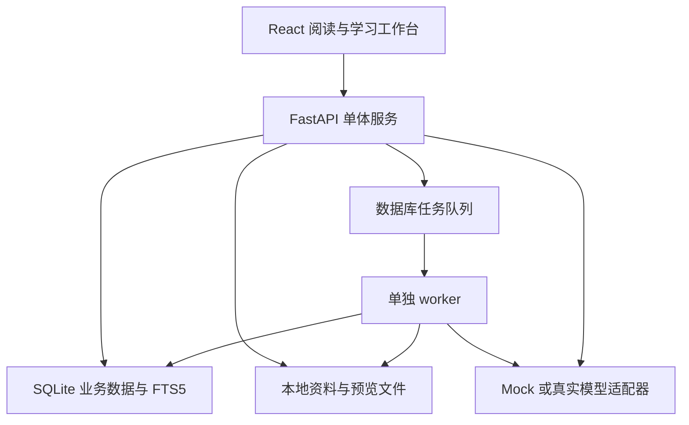

# Hustudy：产品主方案与实施路线

## 1. 已确认事实与设计假设

| 项 | 内容 | 依据与状态 |
|---|---|---|
| 名称 | Hustudy | 用户已确认 |
| 类型 | 工具类 | 用户已确认；适配附件工具类选题 |
| 开发团队 | 4 人 | 成员缩写 zhy/xtc/fzk/gcx 已确认；现行 A/M1、B/M2、C/M3、D/M4 分工见正式方案与 collaboration/roles.md |
| 核心功能 | PPTX/PDF/DOCX 资料阅读与检索、AI 知识点讲解、笔记/资料/图片交叉引用、历年真题考点分析与模拟题生成 | 用户已确认 |
| 当前作业 | 需求分析、AI 协作记录、人工核实说明；个人提交 | 附件明确要求 |
| 架构、指标、规模 | 见下文 | 设计建议，未经过运行或用户调研验证 |

本文继承 StudyLens 的资料—理解—练习—复习闭环；本版将 DOCX、图片引用与真题分析升级为首版核心。首版优先解决大学生专业课和期末复习；考研考公信息聚合是后续扩展，不与核心功能抢工期。

## 2. 产品定义与价值

Hustudy 是把课程 PPTX/PDF/DOCX、个人笔记、图片和历年真题连成一体的 AI 学习平台。学生可以在文档旁边整理笔记，追溯每段解释的来源，再按照自己设置的考试要求生成模拟卷，把错题重新关联回原始知识点。

价值需要通过试用验证，不直接承诺提高成绩。拟验证的改进包括：减少寻找原文与切换文件的时间、降低笔记和资料脱节、让模拟练习覆盖指定章节、为错题提供可执行的回看和复习入口。

NABCD：

| 维度 | Hustudy 的设计 |
|---|---|
| Need | 资料分散、笔记孤立、通用 AI 难追溯出处、临近期末缺少符合课程范围的练习；这些是待访谈验证的问题假设 |
| Approach | 文档定位 + 稳定引用 + 笔记反向链接 + 基于个人资料的 AI 分析 + 蓝图约束出题 |
| Benefit | 用户围绕一门课程完成阅读、整理、提问、练习、纠错，不必手动维护多套来源关联 |
| Competitors | 网盘、Markdown 笔记工具、通用问答与题库是比较维度；实际竞品功能需独立核实，不能声称它们一定缺少上述能力 |
| Delivery | 先用自制或获授权的一门专业课资料开展试用，提供本地启动包、使用指南和演示视频 |

## 3. 代表性使用流程

学生新建“计算机网络”课程，导入课程 PPTX、PDF、DOCX 和 Markdown 笔记，以及三份年份已确认的历史试卷（演示用自制样例）。在阅读 TCP 章节时，把第 12 张幻灯片的原文引用插入“拥塞控制”笔记，并链接到“流量控制”笔记。

学生问“这两个概念的对象和触发条件有什么区别”，AI 仅在当前课程范围检索，回答显示引用入口；资料没有支持的结论标为证据不足。

系统拆题供用户校正，将“拥塞控制”真题映射到相关课件页与笔记，显示题型、年份分布和资料缺口。学生从这些已确认数据提议的蓝图开始修订。

考前创建蓝图：20 道选择题，每题 2 分；4 道简答题，每题 15 分，总分 100；指定章节覆盖和基础/应用难度标签。系统验证章节分配合计 24 题，再生成草稿。用户审阅后开始作答，客观题自动评分，主观题给出 rubric 和建议分。错题可以跳回相应 PPT 页和笔记，并加入次日复习。

数字仅为场景样例，不是所有课程默认题型。不能把以往考试样本统计出的分布解释为教师下一次考试的概率。

## 4. 系统模块与首版范围

| 模块 | P0 首版 | P1 增强 | P2 后续 |
|---|---|---|---|
| 课程资料 | 课程管理、PPTX/PDF/DOCX/MD 上传、解析、状态、阅读定位、删除 | 资料版本差异、扫描试卷 OCR | 旧 PPT 转换、视频字幕 |
| 个人知识库 | 课程分类、标签、全文检索、可校正 Topic 与考点资料映射 | 语义搜索、自动资料对齐、图谱展示 | 跨课自动知识图谱 |
| 笔记双链 | Markdown 编辑、自动保存、笔记双链、资料/图片引用、含附件导出 | 图谱展示、模板、批量整理 | 多人实时编辑、移动同步 |
| AI 学习 | 带来源问答、重点/难点/考点及其依据、学习顺序、例子与自测、保存结果 | 反向费曼、迁移问题、跨资料比较、复习卡片 | 语音讲解、多模态图表理解 |
| 真题分析 | 元数据、AI 拆题与人工校正、考点映射、历年分布、资料缺口、蓝图提议 | 扫描 OCR、跨卷近重复识别 | 外部题库自动抓取 |
| 模拟考试 | 历史蓝图/考点变式/薄弱项练习、来源校验、审阅、作答恢复、判分 | 语义去重、个人自适应难度 | 复杂自动阅卷 |
| 复习管理 | 错题关联、手动复习时间、今日任务、反馈 | 间隔复习、薄弱章节与学习债务排序 | 外部消息提醒 |
| 工程保障 | 用户隔离、可恢复备份、错误状态、测试、说明书 | 更大规模性能优化 | 云端多人服务、第三方登录 |

P0 不承诺自动解析图片内公式、扫描件 OCR 或动画；扫描 PDF 可查看原页并人工补录题目，来源标为人工转录。PPTX 原始排版通过转换 PDF 阅读；不能转换时回退为显式标注的文本视图。旧二进制 `.ppt` 要求用户先另存 PPTX/PDF，不能用 python-pptx 直接解析。

## 5. 界面规划

| 页面 | 主任务与重要交互 |
|---|---|
| 课程首页 | 新建课程、资料与笔记数量、最近阅读、今日复习；无资料时给上传入口 |
| 资料中心 | 四格式资料及图片、进度、错误及重试、标签筛选、下载原件、删除确认 |
| 阅读工作台 | 左侧目录与页码，中间文档，右侧笔记/AI；选择文本→插入引用→点击返回原文 |
| 笔记页 | Markdown/图片编辑与预览、保存状态、来源、出链与反链、冲突处理 |
| 搜索页 | 按课程和类型过滤，显示命中片段；关键词/语义模式有真实状态标识 |
| 真题中心 | 年份/来源、题目拆分校正、考点映射、历史分布、课件匹配与缺口 |
| 知识点报告 | 重点/难点/考点的依据、学习顺序、例题、自测、保存为笔记草稿 |
| 模拟卷蓝图 | 题型、题数、分值、章节整数分配、难度标签、时长；即时显示约束冲突 |
| 审阅与考试页 | 草稿答案审阅；考试中保存恢复和计时；提交后显示答案与反馈 |
| 错题与复习页 | 按章节和错因过滤、回源阅读、再练、完成复习 |
| 设置 | 模型模式、资料发送确认、备份恢复、账号时区、使用帮助 |

在原型阶段覆盖空状态、加载、失败、删除引用、网络中断与无模型配置，避免只画成功页面。

## 6. 技术架构与实现理由



本地部署默认服务绑定回环地址；局域网试用需要明确开放地址、登录与备份安排。阅读、笔记、关键词检索不依赖模型；真实远程 AI 依赖网络与费用配置。Mock 提供有标记的演示结果，不适用于任意上传文档的真实分析。

四人团队优先使用 SQLite 与单 worker，把集成成本放在来源、笔记和试卷的一致性上。向量索引仅为可重建检索副本，业务事实由关系数据库保存；备份包含原始资料、版本、笔记、引用、答案与复习任务，不强制保存可重建向量索引。

## 7. 核心数据关系

| 对象关系 | 设计含义 |
|---|---|
| User → Course → Document → DocumentVersion → Chunk | 资料有归属和不可变版本，定位与来源稳定 |
| Note → NoteLink → Note | 显示名可变，UUID 目标不变；反向链接自动生成 |
| Note/AIResult/Question → Citation → Chunk | 相同引用结构贯穿阅读、分析和练习 |
| ExamBlueprint → ExamPaper → Question | 蓝图约束先校验；题目生成后快照保存 |
| ExamPaper → ExamAttempt → AttemptAnswer | 题目答案在提交前不会传给作答接口 |
| AttemptAnswer → Mistake → ReviewTask | 错题来自真实提交，幂等创建复习入口 |

用户笔记默认是个人观点或记录。笔记中 AI 草稿或未核实内容不能自动成为出题唯一事实依据；可引用原始课程资料，或由用户明确标记笔记已审阅。

## 8. 三个重点工程机制

### 8.1 可追溯的双链知识库

资料引用和笔记链接分开建模。资料引用保存版本、页/幻灯片/标题、原文摘录；笔记链接保存 UUID 和显示名。点击笔记回到原文，阅读页也能展示引用该处的笔记。资料更新保留旧引用版本；删除目标显示失效，不悄悄重定向。

这是可演示、可测试的产品差异点；“同类产品没有”须另做竞品核实。

### 8.2 证据约束 AI 分析

先查授权范围，再检索原文，限制上下文预算，模型只能输出有效来源 ID。后端逐项检查引用；无依据时说明不足。P0 中文关键词搜索足以完成起步闭环；P1 采用关键词和语义检索的 RRF 融合，避免原方案未经归一化的固定加权分数。

检索实验使用人工标注至少 30 个课程查询及正确来源，报告 Top-5 是否包含至少一条正确来源的比例。引用结构有效不等于语义正确，后者另做人工抽查。

### 8.3 蓝图约束的模拟卷

蓝图输入：章节及题数、题型及数量和分值、基础/应用等难度标签、考试时长、资料范围、可选参考样卷。

约束示例：`sum(type.count * type.points) == total_points`；章节题数之和等于题型总题数。P0 为每题分配一个主章节，可附其他涉及章节。跨章节分值约束或复杂比例冲突留到 P1；输入不可满足时拒绝生成并指出冲突。

模型负责生成候选题，程序负责整数配额、引用、选项、标准化重复、预算和状态。用户审阅后才能进入正式模拟。主观题按 rubric 建议评分，用户可以修正；不承诺 AI 判分等价于教师评分。

## 9. 四人核心模块与 40 个课程任务

实际姓名和分工由团队确认；A/B/C/D 为占位角色。每个人都承担开发、测试和文档，任务状态使用 `Todo / Doing / Review / Done / Blocked`。详细分支、接口和合并规则见 `Hustudy_team_collaboration.md`。

| 角色 | 主责模块 | 任务编号与内容 |
|---|---|---|
| A 队长 | 共享基础层 + M1 MaterialHub 资料库 | A01 monorepo/环境；A02 用户、课程、JWT；A03 SQLAlchemy/Alembic 与共享 schema；A04 文件存储/任务状态；A05 上传校验与权限；A06 PPTX/PDF/DOCX/Markdown 解析；A07 预览与文本降级；A08 FTS5/索引；A09 Gitee/CI/启动脚本；A10 集成分支与发布构建 |
| B | M2 AI Study 学习分析 | B01 Provider/Mock；B02 Prompt 版本；B03 检索上下文；B04 课程问答；B05 章节教学讲解；B06 重点/难点/考点报告；B07 引用与坏 JSON 校验；B08 异步任务与进度；B09 AI 评测与异常测试；B10 AI 使用说明 |
| C | M3 NoteGraph 笔记与交叉引用 | C01 Markdown 编辑器；C02 标签/全文检索；C03 UUID 双链；C04 反向链接；C05 图片上传与嵌入；C06 资料 Citation；C07 导出/备份；C08 自动保存与 409 冲突；C09 笔记安全与接口测试；C10 原型和交互说明 |
| D | M4 ExamPilot 真题、模拟题与复习 | D01 真题导入；D02 AI 拆题与人工校正；D03 Topic/课件映射；D04 历史统计与资料缺口；D05 蓝图约束；D06 三种模拟题模式；D07 作答与判分；D08 错题与复习任务；D09 全链路 E2E；D10 用户试用、反馈与汇报演示 |

40 个任务满足教案“功能分解不少于 30 项、每人约 5–10 项”的过程要求。每个任务必须记录需求 ID、输入输出、验收条件、主责、评审者、状态和证据链接；任务数量是计划，不代表已完成。队长先完成共享基础层和 M1 最小闭环，再按 M1 → M2/M3 → M4 的依赖顺序集成。

## 10. 分阶段实施与关口

| 阶段 | 内容 | 通过关口 |
|---|---|---|
| Phase 0 | README、前后端基线、锁文件、数据库、Provider 接口、测试资料 | 健康检查、迁移、前端构建与 Mock 能运行 |
| Phase 1 | 用户、课程、授权 | 两账户访问隔离；重启保存课程 |
| Phase 2 | 四格式上传、解析、阅读、定位、worker | DOCX 段落表格顺序；PPTX/DOCX 预览成功或明确文本降级；失败可恢复 |
| Phase 3 | 笔记、图片、引用、反链、导出 | 回源、重命名、失效、并发冲突全部可复现 |
| Phase 4 | 中文搜索、问答、知识点报告、保存结果 | 有证据/缺证据/模型失败三条路径；真实模式有发送确认 |
| Phase 4A | 真题导入、拆题校正、Topic 映射、历史统计和缺口 | 三份自制样卷，校正可用；未知数据不补造；统计可手工复算 |
| Phase 5 | 三种模式、蓝图、生成校验、审阅、作答判分 | 数量分值精确；无答案泄露；提交幂等与恢复 |
| Phase 6 | 错题、手动复习、备份恢复、反馈 | 错题回源；时区任务正确；备份完整恢复 |
| Phase 7 | E2E、性能测试、用户审阅、说明与发布包 | P0 需求逐项有证据；未达标项如实列出 |
| Phase 8（可选） | 语义检索、资料对齐、费曼、间隔复习 | P0 无回归后再单独验收 |

## 11. 按现行《软件工程实践课程教案》组织评审证据

本节以用户提供的《软件工程实践课程教案(1).docx》为准。教案规定小组最多 4 人；个人提交占 30%（第三次课前需求分析报告 15%，第六次课前项目设计报告 15%），小组提交占 70%，并要求在 Gitee 留下过程记录、源码、可执行版本、测试、说明和用户反馈。

| 教案节点 | Hustudy 必交或必留证据 |
|---|---|
| 第一次课 | 立项、头脑风暴、思维导图、会议记录/照片、NABCD、Gitee 主页 |
| 第二次课 | AI 辅助需求获取与评审记录、用户故事、需求来源和问题清单 |
| 第三次课前 | 需求分析报告、AI 协作与人工核实记录、需求追踪矩阵、第一次沟通修改记录 |
| 第四次课 | 智能开发方法：`AGENTS.md`、Codex 任务模板、分支和评审规则 |
| 第五次课 | 原型、概要/详细设计、架构/数据/算法文档、源码、可执行程序、Gitee 版本记录 |
| 第六次课 | 测试理论、测试计划、单元/API/E2E/性能/权限测试用例 |
| 第七次课 | 测试报告、用户指南、Gitee Pages 或其他可访问发布地址、真实用户反馈与改进记录 |
| 第八次课 | 8 分钟小组演示、PPT、录屏/照片、成员个人项目体会 |

教案评分权重为：问题概述与需求分析 20%，原型/概要设计/详细设计 35%，编码与测试 30%，功能创意 10%，真实用户反馈 5%；项目总评为项目成绩 95% 加考勤 5%。因此 `Hustudy_team_collaboration.md` 的 Wiki 目录、甘特图、四模块任务、发布与反馈清单属于实施要求，不是可选装饰。教案要求发布地址至少维护一个月，Wiki 应包含任务甘特图、每次会议的日期/参与者/目标/决策/待解决问题以及截图、原型链接、测试和反馈证据。

本节不把需求分析个人作业的旧评分表误当作整门课程评分；需求文档仍保留可行性、完整性、可验证性、追溯性和 AI 人工核实内容，作为个人报告与小组设计报告的底稿。

## 12. GitHub 借鉴边界

此前讨论过 Notex、Smart Learn、AI-30-Day-Learning-System 等参考。这里只继承多源资料处理、费曼反馈、学习记录等功能思想，未在本轮核实它们的当前版本、功能或许可证。开发前新增 `docs/third_party.md`，写明实际选定仓库、commit、许可证、采用部分和独立实现部分。

不建议把整个项目直接拼接：来源实体、权限、笔记和题库应统一到 Hustudy。专业课程资料、样卷与测试附件需由成员自行提供获授权版本或自制样例。

## 13. Codex 启动提示

```text
请读取 AGENTS.md、main_idea.md、Hustudy_requirements.md、Hustudy_team_collaboration.md。
项目名称为 Hustudy，4 人开发团队，工具类、本地优先。
先检查当前代码，再实现 Phase 0；不要覆盖现有用户修改。
将需求 ID 与本次任务关联，采用规定目录和共享契约。
完成后运行迁移、测试、类型检查和前端构建，报告真实结果。
未完成的用户调研、模型评估和人工核实必须保持待办状态。
```

项目根目录只保留一套有效的 AGENTS.md；若迁入已有仓库，将本目录的三份文件作为新基线，并确认上级开发规范不会与之冲突。

## 14. v0.3 完整功能设计

### 14.1 AI 阅读：从总结变成可学习的讲解

每份报告使用固定教学结构：

1. 本章学习目标与前置知识；
2. 知识点分层目录和概念关系；
3. 重点及理由、难点与突破步骤；
4. 已观察真题考点与教师标注，单列 AI 推测；
5. 概念→原理→例子→对比→易错点；
6. 三到五个自测问题和复习建议。

用户选择“快速预习/系统自学/考前复习”调整篇幅与练习数量，事实仍来自同一资料。保存为笔记时先创建可编辑草稿，不直接覆盖个人笔记。公式排版可以用 Markdown 数学扩展；解析不可靠的公式标记待核实，不让模型猜符号。

学习报告有自己的 scope 与来源快照。报告生成前可选择课程、章节、笔记是否作为补充资料；AI 草稿默认不能反过来充当事实证据，避免循环引用。

### 14.2 媒体化笔记与双链

用户可在笔记中插入自己上传的图片、课件截图和结构化引用，并查看所有引用某张图/某份资料的笔记。图片 caption/alt、标签和来源可搜索；图片内部文字未识别前不声称可全文搜索。

Obsidian 是交互参考：借鉴内链、反链与附件嵌入的用户体验，不宣称兼容其全部插件。Hustudy 通过 UUID 抵抗重命名与目录变化，并增加可定位的课程资料引用。导出支持：

- 单笔记 Markdown；
- 知识库 ZIP：Markdown + 相对链接图片 + 来源清单；
- 完整账户备份：包含资料、版本、试卷与学习记录。

这三个出口用途不同；普通 Markdown 导出不保证可在外部还原 AI、考试状态和动态来源跳转。

### 14.3 真题研究工作台

步骤：选择课程 → 导入试卷与可选答案 → 设置年份/版本/来源 → AI 按题号与子题拆分 → 对照原文校正 → 提取考点/题型/分值/能力要求 → 匹配课件与知识点 → 人工确认映射 → 历史分析。

支持没有答案的试卷。此时参考解答是 AI 草稿，不能标为标准答案。跨页题、图表题与一题多问保留多来源；图中文字无法解析时显示需补录/OCR，用户可以人工补录并确认。

报告展示：

- 本次分析包含几份卷、哪些年份、多少道已确认题；
- 考点涉及题数、出现年份、已知分值分布；
- 题型和能力标签，如记忆/解释/应用/推导；
- 每个考点对应的课件、笔记、图片、历史题；
- 当前导入资料未匹配的考点；
- 未作答/已练习/错题较多等个人状态。

“历史频率”只描述用户导入样本。课程大纲改变或年份不明时提示统计范围；A/B 卷、重复扫描件等由用户确认独立性，不凭文件名自动当新样本。

### 14.4 考点矩阵与资料缺口

矩阵的行是课程 Topic，列包括历史年份、课件定位、笔记、图片、练习和错题。点击一个单元格回到真实对象。没有匹配显示“当前已导入资料未匹配”，没有作答显示“尚未评测”，避免误判未讲授或未掌握。

这是 P0 的一张关系表与矩阵 UI，无需先建设复杂知识图谱。P1 可加关系图、先修依赖和跨课链接，但基础关系仍保存在 SQLite。

### 14.5 三种模拟题模式

| 模式 | 输入 | 输出与约束 |
|---|---|---|
| 同考点变式 | 已确认真题 + 课件/已审阅答案 | 保留考查目标，改变数值、条件、情景或问法；答案重新推导，不能只改题干 |
| 历史蓝图模拟 | 历史统计 + 用户确认的题数/分值/章节配额 | 匹配试卷结构和知识范围，出新题；显示题型及难度标签而非承诺真实考试难度 |
| 薄弱项专项 | 本人已提交答案与错题 + Topic | 对真实错误关联的概念追加基础题/迁移题；没有作答数据时用用户自选弱项，不虚构掌握度 |

同一试卷可混合模式，但每题记录模式。新题界面显示“设计参考真题”和“答案知识依据”两组来源。题数、分值、章节配额由代码验证，来源与学科正确性仍需要人工评估。

不要只模仿原题表面句式。可以保持“拥塞窗口变化”的目标，改变网络条件和已知值，再要求学生解释变化原因。计算题的公式与结果应有程序校验或明确人工审阅入口；开放题用可编辑 rubric。

## 15. 核心数据、计算与可复现评价

新增对象与状态：

- Topic/TopicSource：名称、别名、章节、资料版本与证据；
- Asset/AssetReference：图片、说明、来源、引用关系；
- PastPaper/PastQuestion：原卷/原题、年份、题号、答案来源、分值、草稿/确认状态；
- QuestionTopicMapping：主/次考点、证据与确认状态；
- ExamAnalysisReport：分析范围、版本快照、统计和缺口。

历史统计建议使用可复算定义：

- 题目涉及率 = 涉及考点 t 的已确认题数 / 本次已确认题数；多标签涉及率加总可以超过 100%。
- 年份出现率 = 涉及 t 的已知不同年份数 / 本次已知不同年份数；年份未知的卷单列，不计入此分母。
- 分值占比 = 主考点为 t 的已知分值之和 / 统计题目的已知分值总和；未知分值不补 0，显示未知占比。
- 个人错题率 = t 对应已判定作答的错误数 / 该范围已判定作答数；无记录显示 unknown，不做零错误推断。

分值总和为 0 或分母为空时显示不可计算。小题拆分后只能在计分叶子分配分值，不能父题和子题同时累计。

评价不是拿 AI 输出再问同一个 AI“是否优秀”。采用人工标注小样本：

1. 至少三份自制/获授权的试卷，含跨页、未知分值、无答案、重复卷等情况；
2. 至少 30 个原题考点映射，以人工结果对照；
3. 至少 20 道新生成题，分别审阅来源、正确性、目标考点与是否实质重复；
4. 对比人工查找/整理和 Hustudy 流程的完成时间、定位错误和修正次数；样本小只做描述性结果，不宣称统计显著。

这类证据有助于课程评审的可验证性与真实性，但不能保证具体分数。

## 16. 实用增强与四人范围控制

优先追加的 P1：

- 复习提纲与可打印知识清单，仍带来源；
- 自测卡片和间隔复习；
- 限定资料问答与自由扩展讲解的模式提示；
- 跨章节知识对比、先修知识补学；
- 考前计划：输入考试日期、每天可用分钟、本人弱项，生成可修改任务，不承诺时间最优；
- 扫描试卷 OCR + 对照校正，先试验中文、公式和版面效果；
- 检索与真题相似度的语义增强；
- AI 任务进度、token/用量记录与费用上限（费用仅按所选服务已核实单价计算）。

这些增强按实际工期选两到三项。P0 首先做一门课、有限格式和已校正题库的完整闭环，不能因新增点让四人失去集成时间。保留现有分层与任务编号，团队确认后才填写实际截止日。

## 17. 高分展示建议

演示围绕一个知识点完成四个可观察动作：

1. 上传课件/教材/图片，生成层次清晰且带依据的讲解；
2. 在阅读中形成笔记与附件双链，演示改名仍可回源；
3. 上传历年题，校正考点后展示“历史题→课件页→笔记”的矩阵及资料缺口；
4. 生成一题实质变式，作答发现错误，跳回依据并安排补练。

展示失败处理：无答案试卷、错误分值、缺少课件依据和被删图片。补充真实用户意见及对应修改，能说明工程质量。

## 18. 本轮技术依据

仅用于核实解析/交互边界，不能当作 Hustudy 已实现证据：

- [python-docx Document API](https://python-docx.readthedocs.io/en/latest/api/document.html)：提供段落/表格正文顺序和内嵌图对象；本方案据此设计 DOCX block 定位。
- [pypdf 文本提取说明](https://pypdf.readthedocs.io/en/stable/user/extract-text.html)：普通文本提取不能替代 OCR；本方案将扫描件识别作为可校正增强模块。
- [Obsidian 内部链接说明](https://help.obsidian.md/links)：内链可关联笔记、附件与文件；本方案借鉴交互，不保证格式/插件完全兼容。

检索日期：2026-10-09。库版本与具体兼容性在初始化时锁定并实测。

## 当前实施增量入口（2026-10-13）

用户本轮指定的 `hustudy/main_idea.md` 已包含团队更新与工作台体验增量；最新体验切片与依赖交付路线见 [collaboration/experience_roadmap.md](collaboration/experience_roadmap.md)，真实验证见 [docs/progress.md](docs/progress.md)。本轮新增课程查找、指定来源/笔记直达和使用指南，未扩大 P0/P1 功能范围。

## 2026-10-13 实施同步：资料来源作为统一基础

本轮按已有需求推进共享层与 M1：不可变资料版本、持久任务 worker、FTS5 中文检索、PDF/转换预览与文本降级、删除撤权。M2 摘录、M3 笔记图片与 Citation、M4 作答共用认证和来源契约。没有扩展 P1/P2 范围。实现与测试详见 docs/progress.md；完整 P0、真实模型、真题统计/来源拟卷和附件备份仍未完成。

## 2026-10-13 实施同步：资料整理与全站一致体验

M1-ORGANIZE-01 在 P0 范围补充资料展示名/分类/标签、精确筛选与版本检索范围、当前版本原文引用笔记查询。共享前端图标/控件/卡片与动效遵循统一风格，提供原文查找/专注阅读及未保存整理保护；不重写 M2/M4 内部。迁移/18 项测试及局部 Safari 证据见 [docs/progress.md](docs/progress.md)，个人记录和交接见 [003](collaboration/handoff.md#h-20261013-zhy-003)。资料标签不代替课程/笔记标签验收，未扩大 P1/P2，也未宣称全部 P0 完成。

## 2026-10-14 实施同步：图像资料可回到原页

队长完成 M1-PREVIEW-ASSET-01：本地 PDF.js 页级读取与当前页图片保存、版本/页号来源、图库回页、来源删除撤权。M3 保留图片嵌入语法，截图不自动进入 AI/OCR/全文搜索。分析与后续依赖见 [M1 缺口分析](docs/zhy/materialhub/materialhub_gap_analysis.md)；22 项测试、PDF.js 实際渲染与浏览器未完成边界见 [进度](docs/progress.md)。不扩大 P1/P2 或冒称全部 P0 完成。

## 2026-10-14 实施同步：扫描资料人工来源

M1-TRANSCRIPT-01 已补原始 PDF 人工草稿/核对确认、独立修订与历史引用、撤回、关键词索引和 source_kind 消费。原 PDF 的解析失败不被伪改为成功；重试恢复的提取文本和人工来源并存。26 项测试/共享检查通过，Safari 补录完整闭环未验收；[进度](docs/progress.md)及[交接](collaboration/handoff.md#h-20261014-zhy-002)保持实际边界，未扩大 P1/P2 或宣称全部 P0 完成。

## 2026-10-14 实施同步：课程图片整理与元数据查找

M1-ASSET-ORGANIZE-01 补齐 FR-37 的图片改名/说明/标签及目录查找/筛选/排序/分页，revision 冲突保留本地输入，原文件/UUID/来源/已存笔记不变。0007 旧图回填与故障回滚可重试，30 项后端与共享检查通过；Safari 图片完整闭环、附件导出/恢复与任务管理仍未验收。[进度](docs/progress.md)、[交接](collaboration/handoff.md#h-20261014-zhy-003)记录实际结果，未扩大 P1/P2 或把局部代码交付当完整 P0 完成。

## 2026-10-14 任务控制与验收增量

共享/M1的取消、恢复、UUID幂等重建及租约迟到保护已实现，失败/取消依赖不通过换新记录绕过预算；无新schema/迁移，不改M2–M4内部。35项后端与共享检查通过，Safari真实课件/状态/重建入口局部观察；完整任务交互、资料/任务分页、附件导出/恢复、压力/全资源验收仍待推进。详见[验收报告](docs/zhy/materialhub/acceptance_2026_10_14.md)与[交接](collaboration/handoff.md#h-20261014-zhy-004)，不扩大P1/P2或把局部通过写为全部完成。

## 2026-10-14 课程资料包与队长验收增量

M1-EXPORT-01交付课程原件/版本/预览/文本/确认补录/图片/来源ZIP和独立hash校验器，后台租约/预算/来源撤权，0008追加表；同时修复SQLite新Session租约恢复。40项测试/共享检查及Safari生成到实际下载/hash验证通过，M2–M4内部未改。资料包不含笔记/AI/考试等数据，不支持恢复；完整账户备份、环境/LO/资源压力/发布关口仍需完成。见[验收与队长十任务映射](docs/zhy/materialhub/material_export_acceptance.md)及[交接005](collaboration/handoff.md#h-20261014-zhy-005)，不扩大P1/P2或把局部交付冒充全部P0完成。

## 2026-10-14 共享课程整理增量

PLATFORM-COURSE-01落实正式A02的课程名称/描述/分类/标签整理、筛选及revision冲突保护；0009追加列，来源/笔记关系保持。43项自动检查通过；Safari自制课程/双标签页冲突实测，最终界面补丁部分复验待补。课程删除清理、资料/任务分页、完整恢复、环境/发布仍待验收，未扩大P1/P2或标全部P0完成。[验收](docs/zhy/shared_platform/course_organization_acceptance.md)、[交接006](collaboration/handoff.md#h-20261014-zhy-006)。

## 2026-10-14 基础验收与课程删除

PLATFORM-COURSE-DELETE-01补齐课程逻辑撤权、影响预览/revision/名称确认、模块同事务清理与失效来源保持；0010追加列。47项回归与共享检查通过，Safari预览保护通过，用户库没有执行删除。M2–M4适配仅生命周期/授权；标准JWT迁移、完整恢复/附件ZIP、真题统计与真实生成、性能/环境/完整E2E与发布仍待完成，未把自动通过写成全部P0完成。[验收矩阵](docs/zhy/shared_platform/basic_acceptance.md)、[交接007](collaboration/handoff.md#h-20261014-zhy-007)。

## 2026-10-14 智谱真实问答增量

用户指定GLM-4.7-Flash，M2-ZHIPU-QA-01交付后端配置/M1有界来源/不可变预览/明确确认/单次后台任务/JSON与原文校验/真实结果回源和冻结引用草稿，0011。67项检查与自制真实417tokens请求通过，Safari模式入口观察；政策细项与完整浏览器闭环待补。真实章节报告/M4生成未自动接入，其他P0与环境/性能/发布关口保持待办。[验收](docs/zhy/integration/zhipu_qa_acceptance.md)、[交接008](collaboration/handoff.md#h-20261014-zhy-008)。不记录密钥、不冒记xtc本人工作。


## 2026-10-15 用户原格式预览变更

M1支持PPTX/PDF/DOCX按源格式直接阅读：PPT按幻灯片，Word保留基础段落/样式/表格/图片，PDF按原页。Office原件本地浏览器隔离渲染，不再必须等待PDF转换；LibreOffice转PDF保留为明确的兼容预览/截图路径，正文引用仍按不可变版本与原定位。首版不含旧二进制.ppt/.doc、编辑和完整动画。该用户新要求覆盖早期“PPTX仅转PDF预览”的产品入口约定，技术/验收见公共contracts及zhy材料目录。


2026-10-15用户界面增量：全站适配电脑/iPad/手机，采用共享紧凑密度、窄屏抽屉导航及可折叠资料/笔记列表；文档原格式排版独立。契约PLATFORM-RESPONSIVE-01，范围与证据见[响应式验收](docs/zhy/shared_platform/responsive_layout_acceptance.md)，正式方案与需求基线同步记录。
